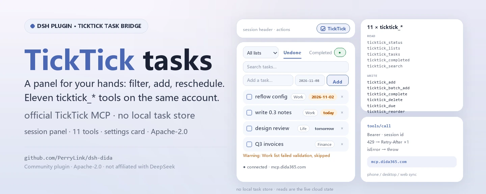
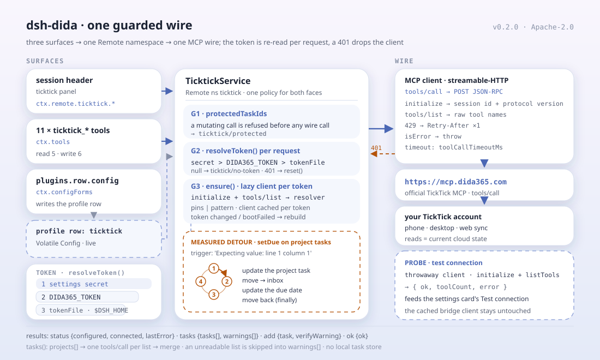

<div align="center">

<picture>
  <source media="(prefers-color-scheme: dark)" srcset="docs/assets/dsh-dida-hero-en-dark.webp">
  
</picture>

# dsh-dida

**Run your TickTick / Dida365 to-dos right from the session header — filter, quick-add, complete, reschedule, drag-reorder, and hand the rest to eleven agent tools.**

A TickTick / Dida365 task bridge for DeepSeek Harness: a Session-header task panel, eleven `ticktick_*` tools, a configuration card on the Plugins page, and a typed Remote service — all over the official TickTick MCP endpoint.

[Install](#three-step-setup) · [Configuration](#configuration) · [FAQ](#faq) · [简体中文](README.md) · [English](README.en.md) · [Español](README.es.md) · [Português](README.pt.md) · [हिन्दी](README.hi.md)

[](LICENSE)
[](#compatibility)
[](https://www.npmjs.com/package/dsh-dida)
[](https://github.com/PerryLink/dsh-dida/actions/workflows/ci.yml)
[](#compatibility)

[](https://github.com/PerryLink/dsh-dida/stargazers)
[](https://www.npmjs.com/package/dsh-dida)
[](https://dshfind.com/plugins/PerryLink/dsh-dida?ref=badge)
[](https://dsh.market/)
[](https://gitee.com/perrylink/dsh-dida)

```sh
dsh plugin --profile <name> add dsh-dida
```

</div>

<sub>Community plugin, not affiliated with DeepSeek. Canonical repository: <https://github.com/PerryLink/dsh-dida> (Gitee is a mirror). The old npm package `@perrylink/dsh-ticktick` is deprecated; install `dsh-dida`.</sub>

## What it is

`dsh-dida` brings TickTick / Dida365 into DeepSeek Harness: the Session header gains a `ticktick` panel for filtering by list, quick-adding, completing, deleting with confirmation, setting or clearing due dates, and drag-reordering; when no token is configured the panel offers one-step in-panel setup. The model gets eleven `ticktick_*` tools for lists, task CRUD, due dates, reordering, completed queries, search, and batch add, plus a configuration card on the Plugins page. Every read and write goes through the official TickTick MCP endpoint and lands on your TickTick cloud account, so the phone, desktop, and web apps see it — the plugin keeps no local task store of its own.

<div align="center">

<picture>
  <source media="(prefers-color-scheme: dark)" srcset="docs/assets/dsh-dida-flow-v5-dark.svg">
  
</picture>

</div>

## Three-step setup

1. **Install** (pick one channel):

   ```sh
   # git channel (latest main; equivalent to git+https://github.com/PerryLink/dsh-dida.git)
   dsh plugin --profile web add github:PerryLink/dsh-dida
   # npm channel (published releases; lib/ ships in the tarball, no build permission needed)
   dsh plugin --profile web add dsh-dida
   # git source pinned to a commit (pnpm asks you to allow the prepare build once)
   dsh plugin --profile web add "github:PerryLink/dsh-dida#<sha>"
   # tarball channel: pnpm pack in this repo, then
   dsh plugin --profile web add ./dsh-dida-<version>.tgz
   # local development
   dsh plugin --profile web add link:/path/to/dsh-dida
   ```

   Restart `dsh web` (bundle plugins activate on restart). The `ticktick` action appears in the Session header; its configuration page opens from the **Configure** control on the TickTick row of the Plugins page.

2. **Minimal config** (defaults work; pick one token source):

   ```yaml
   - insert:
       - id: ticktick
         name: dsh-dida
         config:
           mcpUrl: https://mcp.dida365.com
   ```

   Token priority, highest first: the configuration card's secret field, the `DIDA365_TOKEN` environment variable, the token file (default `$DSH_HOME/.ticktick-token`, one line). Writing the file activates the bridge without any config change.

3. **Verify it mounts**:

   ```sh
   dsh --profile web --dump-config | grep -A2 'id: ticktick'
   ```

   ```
   > ticktick_lists
   Inbox (inbox)
   Work (hex1)
   ```

   If `ticktick_lists` (or the header panel) shows your lists, the token and endpoint are live.

**Uninstall**: `dsh plugin --profile web remove dsh-dida`. Restart `dsh web`. All runtime registrations (tools, panel, configuration page, prompt section) are removed with the plugin. The only static residue is the token in the user settings document — clear it first with the **Clear credentials** button on the TickTick configuration page (or remove the token file / `DIDA365_TOKEN` variable) to detach completely. To keep the package installed but inactive, disable the row instead:

```yaml
- id: ticktick
  disabled: true
```

<details>
<summary>Install from the DSH Desktop market</summary>

Every PerryLink plugin is listed in the built-in DSH Desktop market: **Market → Sources → Add source → paste** `https://perrylink-dsh-catalog.perrylink.workers.dev/catalog-source.json` **→ select**. Installation still requires the market's npm identity check and your confirmation.

</details>

## Core capabilities

`dsh-dida` makes TickTick a first-class citizen of the session: the panel is for your fingers, the tools are for the model, the configuration card is for the token — the tasks themselves stay in the TickTick cloud.

- **Session-header panel** — filter by list (All + every list), toggle undone/completed views, full-text search, add tasks with an optional due date, complete, delete with confirmation, set/clear due dates with overdue/today/tomorrow chips, and drag-reorder inside single-list undone views. A status dot shows the connection state; when no token is configured the panel offers one-step in-panel token setup.
- **Eleven agent tools** — status, lists, tasks, add/complete/delete, due dates, reorder, completed, search, and batch add; Code Mode gets `await tools.ticktick_*(args)` for free.
- **Configuration card** — Plugins page → the TickTick row → **Configure**: API token (secret), token file, MCP endpoint (CN/International presets), protected task ids; all four apply live without a restart, plus **Test connection** and **Clear credentials** buttons.
- **Live token re-read** — the Bearer token is re-read per request (card secret > `DIDA365_TOKEN` > token file, default `$DSH_HOME/.ticktick-token`); a 401 resets the client so a rotated token activates without a restart.
- **Measured workarounds** — the TickTick MCP server rejects `update_task` for tasks inside regular projects (`Expecting value: line 1 column 1`); the bridge retries via a move-to-inbox → update → move-back detour. Lists that fail server-side validation (historical `repeatFrom: ''` data) are skipped and reported as per-list warnings, never silently dropped.
- **Protected ids** — mutating operations refuse tasks on the protected-id list before any wire call.
- **Multi-device sync** — every write lands on the TickTick cloud account, so the phone/desktop/web apps see it; every read fetches current state.

### Agent tools

| Tool | Purpose |
|---|---|
| `ticktick_status` | connection state: token configured, client connected, endpoint, last error |
| `ticktick_lists` | every list (project), the virtual Inbox included |
| `ticktick_tasks` | undone tasks: one list or all aggregated, with per-list warnings |
| `ticktick_add` | create a task (list, optional ISO due date) |
| `ticktick_complete` | complete a task (task id + list id) |
| `ticktick_delete` | delete a task (task id + list id) |
| `ticktick_due` | set/clear a due date (omit the date to clear) |
| `ticktick_reorder` | assign a new integer sortOrder (lists order by descending sortOrder) |
| `ticktick_completed` | tasks completed within a window (default 30 days), optionally one list |
| `ticktick_search` | full-text search over tasks (the official search tool) |
| `ticktick_batch_add` | create several tasks in one call |

### Architecture

```
browser panel ── ctx.remote.ticktick.* ──▶ TicktickService (Typert Remote)
configuration page ── ctx.configForms ──▶ profile entry "ticktick" (Volatile Config)
agent tools ─── ctx.tools (ticktick_*) ──▶ the same service
                    │
                    ▼
        minimal streamable-HTTP MCP client
        (session id, protocol version, Retry-After)
                    │
                    ▼
        https://mcp.dida365.com  (official TickTick MCP)
```

### Examples

These are the plugin's real entry points; install once, then call one.

#### Detailed example

**Command**

~~~sh
ticktick_lists
~~~

**Input**

~~~json
{}
~~~

**Output**

~~~text
Inbox (inbox)
Work (hex1)
~~~

*Observed from `plugins/dsh-dida/src/tools.ts:107-109 (renderer); fixture/assertion at plugins/dsh-dida/tests/service.spec.ts:40-46,103-108`*

#### Failure branch

**Input**

~~~text
{"id":"t-guarded","projectId":"hex1"} (protectedTaskIds: ["t-guarded"])
~~~

**Output**

~~~text
Error: task t-guarded is protected
~~~

*Observed from `plugins/dsh-dida/src/service.ts:344-349; plugins/dsh-dida/tests/service.spec.ts:158-163`*

#### Brief examples

- `ticktick_tasks`
- `ticktick_add`

## Configuration

All tunables are Schemastery `Config` fields (overridable from cordis.yml). An id-targeted override replaces the whole row — restate every key you need. `cordis.patch.yml` documents each key inline.

How to get a token:

1. In the Dida365/TickTick web app, open Profile → Settings → Account & Security → API token (a `dp_`-prefixed token).
2. Pick one of three token sources (priority order): the TickTick configuration page's secret field, the `DIDA365_TOKEN` environment variable, or a token file (default `$DSH_HOME/.ticktick-token`, one line).
3. Use the card's **Test connection** button to verify the token and **Clear credentials** to wipe it.

Most-used keys:

| Key | Default | Meaning |
|---|---|---|
| `token` | `''` | Bearer token typed into the configuration card's secret field; highest priority |
| `tokenFile` | `''` | Path to a text file holding the token; empty resolves to `$DSH_HOME/.ticktick-token` |
| `mcpUrl` | `https://mcp.dida365.com` | TickTick MCP endpoint (the international endpoint is unverified — see Known limitations) |
| `toolCallTimeoutMs` | `30000` | Per tools/call deadline in milliseconds, 1000–300000 |
| `protectedTaskIds` | `[]` | Task ids every mutating operation refuses before any wire call |
| `tools.*` | `''` each | Raw MCP tool-name pins; `''` = discover by pattern |

<details>
<summary>Full configuration table (16 keys)</summary>

| Key | Default | Meaning |
|---|---|---|
| `token` | `''` | Bearer token typed into the configuration card's secret field; highest priority |
| `tokenFile` | `''` | Path to a text file holding the token; empty resolves to `$DSH_HOME/.ticktick-token` |
| `mcpUrl` | `https://mcp.dida365.com` | TickTick MCP endpoint (the international endpoint is unverified — see Known limitations) |
| `toolCallTimeoutMs` | `30000` | Per tools/call deadline in milliseconds, 1000–300000 |
| `protectedTaskIds` | `[]` | Task ids every mutating operation refuses before any wire call |
| `tools.projects` | `''` | Raw name pin for the project-list tool; `''` = discover by pattern |
| `tools.tasks` | `''` | Raw name pin for the undone-tasks tool; `''` = discover by pattern |
| `tools.create` | `''` | Raw name pin for the create-task tool; `''` = discover by pattern |
| `tools.complete` | `''` | Raw name pin for the complete-task tool; `''` = discover by pattern |
| `tools.remove` | `''` | Raw name pin for the delete-task tool; `''` = discover by pattern |
| `tools.update` | `''` | Raw name pin for the update-task tool; `''` = discover by pattern |
| `tools.move` | `''` | Raw name pin for the move-task tool; `''` = discover by pattern |
| `tools.completed` | `''` | Raw name pin for the completed-query tool; `''` = discover by pattern |
| `tools.search` | `''` | Raw name pin for the search tool; `''` = discover by pattern |
| `tools.getTask` | `''` | Raw name pin for the get-task-by-id tool; `''` = discover by pattern |
| `tools.batchAdd` | `''` | Raw name pin for the batch-add tool; `''` = discover by pattern |

</details>

Example override in your profile patch:

```yaml
- insert:
    - id: ticktick
      name: dsh-dida
      config:
        mcpUrl: https://mcp.dida365.com
        toolCallTimeoutMs: 30000
        protectedTaskIds: [t-guarded]
```

## FAQ

<details>
<summary>Who stores the token, and where is it sent?</summary>

The token has three sources: the configuration card's secret field (stored in the host's settings document), the `DIDA365_TOKEN` environment variable, and a token file (default `$DSH_HOME/.ticktick-token`). The plugin re-reads it per request and only sends it as a Bearer header to `mcp.dida365.com`. The card's token field carries `role('secret')`, so the host redacts it from every form response, and the configuration page writes path-addressed edits instead of rebuilding the section wholesale. The `/api` surface is the standard harness Typert gateway; the plugin runs no extra HTTP server.

</details>

<details>
<summary>Do TickTick server-side failures fail silently?</summary>

Nothing is silent. The TickTick MCP server rejects `update_task` for tasks inside regular projects (`Expecting value: line 1 column 1`), so the bridge retries through move-to-inbox → update → move-back. Lists that fail server-side validation (historical `repeatFrom: ''` data) are skipped and surfaced as per-list warnings. Protected-id refusals happen before any wire call, and `ticktick_status` reports the connection state and the last error.

</details>

<details>
<summary>Does it fight other plugins over commands, tool names, or slots?</summary>

No. All eleven tools carry the `ticktick_` prefix; it registers one `ticktick` Remote namespace, one Session-header action (id `ticktick`), and one `plugins.row.config` entry; it registers no `webServer` routes and mutates no globals. The point-by-point argument is in "Interoperability with other DSH plugins".

</details>

<details>
<summary>How big is the performance overhead?</summary>

There is no background polling and no local task index: the panel and the tools issue one MCP call on demand and always read the current cloud state; a single call is capped by `toolCallTimeoutMs` (30 seconds by default). The token is re-read per request, and a 401 resets the client, so a rotated token needs no restart.

</details>

<details>
<summary>What happens with no token, or when the endpoint is unreachable?</summary>

The panel's status dot shows the connection state, and with no token configured the panel offers one-step in-panel setup. From the model side, `ticktick_status` reports "token configured / client connected / endpoint / last error"; every other tool surfaces the error instead of inventing task data.

</details>

## Security boundaries

- **The token stays local and goes only to TickTick.** It lives in the host settings document or in your own token file, and the plugin sends it as a Bearer header only to `mcp.dida365.com`. Do not expose a `dsh web` instance to the public internet.
- **The secret field is redacted by the host.** The token field carries `role('secret')`, so the host strips it from every form response; the configuration page performs path-addressed writes and never rebuilds the section, which would delete the stored token.
- **Protected ids come before the wire.** Tasks in `protectedTaskIds` are refused before any mutating operation makes a network call.
- **Failures stay visible.** A 401 resets the client; lists that fail server-side validation are surfaced as per-list warnings rather than silently dropped; `ticktick_status` exposes the last error.
- **Registrations are effects.** The service, tools, system-prompt section, and settings form are all Cordis effects — unload or hot-reload removes them.

## Permissions & data

- **Permissions**: the `dshWorkshop` manifest declares `browser:local-storage`, `settings:read`, `settings:write`, and `network:https://mcp.dida365.com`; `dsh.capabilities` lists `network:egress` and `tools:register`.
- **Data**: tasks and lists stay in your TickTick cloud account; the plugin keeps no local task store and persists only the token and configuration (host settings document or your own token file).
- **Remote surface**: the panel goes through `ctx.remote.ticktick.*` over the harness's standard Typert gateway; the plugin runs no HTTP server of its own.

## Known limitations

- The international TickTick endpoint is **unverified**: `mcpUrl` defaults to the CN endpoint, and the international MCP URL has not been probed.
- The completed view, search, and batch add ride the MCP tools `list_completed_tasks_by_date`, `search`, and `batch_add_tasks`; their wire contracts come from the published catalogue (`dida365-sdk` stubs) and **re-verification against the live endpoint is pending** — run `probes/probe-queries.mjs` with a real token before claiming them verified.
- The measured `update_task` crash and the list-validation failure are server-side behaviors; `probes/` re-verifies them against the live endpoint before a release (run with `DIDA365_TOKEN` exported).
- The `/api` surface the panel uses is the standard harness Typert gateway; the token is stored locally (settings document or token file) and sent only to TickTick's own servers. Do not expose a `dsh web` instance to the public internet.

## Interoperability with other DSH plugins

Checked against this repository's source and bundle declaration, `dsh-dida` keeps its contact surface deliberately narrow:

- **Every tool name is prefixed.** All eleven tools are `ticktick_*`; no bare name owned by a shipped tool or another plugin is registered.
- **One Remote namespace only.** The service key is `ticktick`; only a plugin claiming the same `ticktick` namespace could collide with it.
- **Two named client slots.** The Session-header action `ticktick` (order 11) and the Plugins-row configuration page `@perrylink/dsh-ticktick#ticktick`; the page only appears when its row exists, and no other slot is registered.
- **No `webServer` prefix**, no prototype patching, no `process.env` rewrites, and no replacement of the global fetch dispatcher.
- **The patch only inserts its own row.** `cordis.patch.yml` never overrides a built-in row's `config`; an id-targeted override must restate the whole row.
- **It keeps its own minimal MCP client.** `src/mcp.ts` does not adopt the `@deepseek-ai/dsh-mcp-client` supervisor shape — that package registers `mcp__<server>__<tool>` tools and would replace the eleven curated names; this plugin keeps its own transport and its measured detours.

So it does not contend with built-in tools or other plugins for names, routes, or global state; the only namespace to avoid is another `ticktick` service.

## Compatibility

| Surface | Status |
|---|---|
| Harness | DeepSeek Harness **dsh-v0.2.1-alpha.1** (GitHub tag). npm dependency line pinned to `@deepseek-ai/dsh` **0.2.1-alpha.1** (peers `>=0.1.2-rc.1 <0.2.0 \|\| >=0.1.5-alpha.1 <0.2.0 \|\| >=0.1.6-0 <0.2.0 \|\| >=0.1.7-0 <0.2.0 \|\| >=0.2.0-0 <0.3.0 \|\| >=0.2.1-0 <0.3.0`). Verified against the dsh-v0.2.1-alpha.1 checkout (full gate chain + profile install smoke). |
| Node | `^22.19.0 \|\| >=24.0.0` |
| Platforms | Anywhere DSH runs; the task panel needs a web client (`dsh web`) |
| Model | Any text model with tool calling; no extra model capability required |

## Ecosystem & quality

- [Gitee mirror](https://gitee.com/perrylink/dsh-dida) (sync mirror; GitHub is canonical)
- [dshfind plugin page](https://dshfind.com/plugins/PerryLink/dsh-dida) (installs and ranking)
- [dsh-plugin-doctor verification report](https://github.com/PerryLink/dsh-plugin-doctor#verified-徽章) (the report the repository badge points at)
- [DSH Market](https://dsh.market/) (listed)
- **1024 store channel**: `npm i -g dsh1024` once, then `dsh1024 plugin --profile web add dsh-dida` (counts toward the [deepseek1024.com](https://deepseek1024.com) install ranking)
- [Ecosystem knowledge base](https://perrylink.github.io/dsh-plugin-guide/) — measured data, not marketing: plugin development guide · plugin-selection data · maintenance criteria

## Development

```sh
pnpm install                                       # node ^22.19 || >=24
pnpm run typecheck && pnpm run typecheck:ci        # two rulers: checkout face (guarded; unverifiable without the checkout) + published-line face
pnpm test                                          # vitest
pnpm run build                                     # scripts/prepare.mjs: tsc declarations + tsdown bundles
pnpm run verify:self-contained                     # dependency specs resolve from the registry
pnpm run verify:artifacts                          # shipped files present + artifacts importable
pnpm run check:readmes                             # five-language README consistency
pnpm pack                                          # the published tarball
```

Build output lives in `lib/`: `lib/index.js`, `lib/typert.host.js`, `lib/client.js`, and `lib/types/`. The README images are generated programmatically by [`scripts/gen-readme-assets.py`](scripts/gen-readme-assets.py) (Pillow for the hero, hand-written SVG for the structure figure) and are safe to re-run: `python scripts/gen-readme-assets.py` writes `docs/assets/dsh-dida-hero-{zh,en}-{light,dark}.webp` and `docs/assets/dsh-dida-flow-v5-{light,dark}.svg` (localized hero, token-only structure figure shared by all five languages).

### Verify against the live endpoint

```sh
# PowerShell
$env:DIDA365_TOKEN='dp_...'
node probes/probe-bootstrap.mjs      # handshake + tool catalogue
node probes/probe-crud.mjs           # create/complete/delete round trip
node probes/probe-due.mjs            # due dates (+ detour with a PROJECT_ID)
node probes/probe-reorder.mjs        # sortOrder semantics
node probes/probe-queries.mjs        # P2 query-tool contract discovery
```

Topics: `dsh`, `dsh-plugin`, `deepseek-harness`, `deepseek`, `cordis`, `ticktick`, `dida365`, `todo`, `task`, `mcp`, `widget`

## Family & thanks

This project is part of the DeepSeek Harness plugin family from [PerryLink](https://github.com/PerryLink) (all Apache-2.0). If it is useful, **a star helps the next person find it** — nothing is gated behind it.

- [@PerryLink](https://github.com/PerryLink) — creator and maintainer: the Session-header task panel, the eleven `ticktick_*` tools, the configuration card, the typed Remote service, and the five-language docs.

<details>
<summary>Expand all plugins</summary>

| Plugin | Status |
|---|---|
| **[dsh-aqua-input-check](https://github.com/PerryLink/dsh-aqua-input-check)** |  |
| **[dsh-archive-check](https://github.com/PerryLink/dsh-archive-check)** |  |
| **[dsh-auto-review](https://github.com/PerryLink/dsh-auto-review)** |  |
| **[dsh-autotier](https://github.com/PerryLink/dsh-autotier)** | 🧊 FROZEN — see the repo README |
| **[dsh-bid-ca-precheck](https://github.com/PerryLink/dsh-bid-ca-precheck)** |  |
| **[dsh-bid-qual-check](https://github.com/PerryLink/dsh-bid-qual-check)** |  |
| **[dsh-cert-mcp](https://github.com/PerryLink/dsh-cert-mcp)** | 🧊 FROZEN — see the repo README |
| **[dsh-checkpoint-rewind](https://github.com/PerryLink/dsh-checkpoint-rewind)** |  |
| **[dsh-click](https://github.com/PerryLink/dsh-click)** |  |
| **[dsh-composer-history](https://github.com/PerryLink/dsh-composer-history)** |  |
| **[dsh-contract-stance](https://github.com/PerryLink/dsh-contract-stance)** |  |
| **[dsh-customs-doc-check](https://github.com/PerryLink/dsh-customs-doc-check)** |  |
| **[dsh-data-quality](https://github.com/PerryLink/dsh-data-quality)** | 🧊 FROZEN — see the repo README |
| **[dsh-demurrage-ledger](https://github.com/PerryLink/dsh-demurrage-ledger)** |  |
| **[dsh-doublecheck](https://github.com/PerryLink/dsh-doublecheck)** |  |
| **[dsh-drill-script-check](https://github.com/PerryLink/dsh-drill-script-check)** |  |
| **[dsh-eia-guide-check](https://github.com/PerryLink/dsh-eia-guide-check)** |  |
| **[dsh-emergency-plan](https://github.com/PerryLink/dsh-emergency-plan)** |  |
| **[dsh-essay-rubric-check](https://github.com/PerryLink/dsh-essay-rubric-check)** |  |
| **[dsh-evidence-check](https://github.com/PerryLink/dsh-evidence-check)** |  |
| **[dsh-export-ctl-check](https://github.com/PerryLink/dsh-export-ctl-check)** |  |
| **[dsh-fast](https://github.com/PerryLink/dsh-fast)** |  |
| **[dsh-fmea-table-check](https://github.com/PerryLink/dsh-fmea-table-check)** |  |
| **[dsh-forecast-penalty](https://github.com/PerryLink/dsh-forecast-penalty)** |  |
| **[dsh-fund-research](https://github.com/PerryLink/dsh-fund-research)** |  |
| **[dsh-github](https://github.com/PerryLink/dsh-github)** |  |
| **[dsh-gongwen-flow-check](https://github.com/PerryLink/dsh-gongwen-flow-check)** |  |
| **[dsh-gongwen-word-check](https://github.com/PerryLink/dsh-gongwen-word-check)** |  |
| **[dsh-guard-plan-qc](https://github.com/PerryLink/dsh-guard-plan-qc)** |  |
| **[dsh-hazchem-check](https://github.com/PerryLink/dsh-hazchem-check)** |  |
| **[dsh-hazplan-check](https://github.com/PerryLink/dsh-hazplan-check)** |  |
| **[dsh-hidden-risk-map](https://github.com/PerryLink/dsh-hidden-risk-map)** |  |
| **[dsh-hs-classify](https://github.com/PerryLink/dsh-hs-classify)** |  |
| **[dsh-icd-rule-check](https://github.com/PerryLink/dsh-icd-rule-check)** |  |
| **[dsh-industry-research](https://github.com/PerryLink/dsh-industry-research)** |  |
| **[dsh-lawcite-adapter](https://github.com/PerryLink/dsh-lawcite-adapter)** |  |
| **[dsh-laya](https://github.com/PerryLink/dsh-laya)** |  |
| **[dsh-lc-doc-check](https://github.com/PerryLink/dsh-lc-doc-check)** |  |
| **[dsh-learning-gap-check](https://github.com/PerryLink/dsh-learning-gap-check)** |  |
| **[dsh-library](https://github.com/PerryLink/dsh-library)** |  |
| **[dsh-local-ai](https://github.com/PerryLink/dsh-local-ai)** |  |
| **[dsh-lsp-actions](https://github.com/PerryLink/dsh-lsp-actions)** |  |
| **[dsh-mask](https://github.com/PerryLink/dsh-mask)** |  |
| **[dsh-mcp-panel](https://github.com/PerryLink/dsh-mcp-panel)** |  |
| **[dsh-medrec-qc](https://github.com/PerryLink/dsh-medrec-qc)** |  |
| **[dsh-memento](https://github.com/PerryLink/dsh-memento)** | 🧊 FROZEN — see the repo README |
| **[dsh-nsfc-form-check](https://github.com/PerryLink/dsh-nsfc-form-check)** |  |
| **[dsh-nurse-record-check](https://github.com/PerryLink/dsh-nurse-record-check)** |  |
| **[dsh-observe](https://github.com/PerryLink/dsh-observe)** |  |
| **[dsh-origin-rvc-check](https://github.com/PerryLink/dsh-origin-rvc-check)** |  |
| **[dsh-ota-review-check](https://github.com/PerryLink/dsh-ota-review-check)** |  |
| **[dsh-output-styles](https://github.com/PerryLink/dsh-output-styles)** |  |
| **[dsh-paper-doc-adapter](https://github.com/PerryLink/dsh-paper-doc-adapter)** |  |
| **[dsh-permission-rules](https://github.com/PerryLink/dsh-permission-rules)** |  |
| **[dsh-permit-report-check](https://github.com/PerryLink/dsh-permit-report-check)** |  |
| **[dsh-pipeline-check](https://github.com/PerryLink/dsh-pipeline-check)** |  |
| **[dsh-pleading-draft](https://github.com/PerryLink/dsh-pleading-draft)** |  |
| **[dsh-plugin-doctor](https://github.com/PerryLink/dsh-plugin-doctor)** | 🚫 RETIRED (repo archived) |
| **[dsh-plugin-guide](https://github.com/PerryLink/dsh-plugin-guide)** |  |
| **[dsh-plugin-kit](https://github.com/PerryLink/dsh-plugin-kit)** | 🚫 RETIRED (repo archived) |
| **[dsh-plugin-upgrade](https://github.com/PerryLink/dsh-plugin-upgrade)** | 🚫 RETIRED (repo archived) |
| **[dsh-policy-brief-draft](https://github.com/PerryLink/dsh-policy-brief-draft)** |  |
| **[dsh-power-loss-split](https://github.com/PerryLink/dsh-power-loss-split)** |  |
| **[dsh-power-ticket-check](https://github.com/PerryLink/dsh-power-ticket-check)** |  |
| **[dsh-ppap-check](https://github.com/PerryLink/dsh-ppap-check)** |  |
| **[dsh-protest-deadline](https://github.com/PerryLink/dsh-protest-deadline)** |  |
| **[dsh-railway-window](https://github.com/PerryLink/dsh-railway-window)** |  |
| **[dsh-repair-order-qc](https://github.com/PerryLink/dsh-repair-order-qc)** |  |
| **[dsh-research-report](https://github.com/PerryLink/dsh-research-report)** |  |
| **[dsh-review-reply-check](https://github.com/PerryLink/dsh-review-reply-check)** |  |
| **[dsh-rulefile-check](https://github.com/PerryLink/dsh-rulefile-check)** |  |
| **[dsh-safety-brief-check](https://github.com/PerryLink/dsh-safety-brief-check)** |  |
| **[dsh-score](https://github.com/PerryLink/dsh-score)** | 🧊 FROZEN — see the repo README |
| **[dsh-session-sync](https://github.com/PerryLink/dsh-session-sync)** |  |
| **[dsh-site-log-check](https://github.com/PerryLink/dsh-site-log-check)** |  |
| **[dsh-skill-pack-security](https://github.com/PerryLink/dsh-skill-pack-security)** |  |
| **[dsh-soe-decision-check](https://github.com/PerryLink/dsh-soe-decision-check)** |  |
| **[dsh-soilwater-check](https://github.com/PerryLink/dsh-soilwater-check)** |  |
| **[dsh-sop-sync-check](https://github.com/PerryLink/dsh-sop-sync-check)** |  |
| **[dsh-spc-gbt-adapter](https://github.com/PerryLink/dsh-spc-gbt-adapter)** |  |
| **[dsh-talk](https://github.com/PerryLink/dsh-talk)** |  |
| **[dsh-tender-extract](https://github.com/PerryLink/dsh-tender-extract)** |  |
| **[dsh-tender-matrix](https://github.com/PerryLink/dsh-tender-matrix)** |  |
| **[dsh-test-drive](https://github.com/PerryLink/dsh-test-drive)** |  |
| **[dsh-dida](https://github.com/PerryLink/dsh-dida)** |  |
| **[dsh-translate](https://github.com/PerryLink/dsh-translate)** |  |
| **[dsh-warranty-calc](https://github.com/PerryLink/dsh-warranty-calc)** |  |
| **[dsh-budget](https://github.com/PerryLink/dsh-budget)** | 🧊 FROZEN — see the repo README |
| **[dsh-claude-move](https://github.com/PerryLink/dsh-claude-move)** | 🧊 FROZEN — see the repo README |
| **[dsh-defend](https://github.com/PerryLink/dsh-defend)** | 🧊 FROZEN — see the repo README |
| **[dsh-draw](https://github.com/PerryLink/dsh-draw)** | 🧊 FROZEN — see the repo README |
| **[dsh-reach](https://github.com/PerryLink/dsh-reach)** | 🧊 FROZEN — see the repo README |
| **[dsh-background-agents](https://github.com/PerryLink/dsh-background-agents)** | 🚫 RETIRED (repo archived) |
| **[dsh-session-pin](https://github.com/PerryLink/dsh-session-pin)** | 🚫 RETIRED (repo archived) |
| **[dsh-team-rooms](https://github.com/PerryLink/dsh-team-rooms)** | 🚫 RETIRED (repo archived) |

</details>

## License

[LICENSE](LICENSE) (Apache License 2.0) © 2026 dsh-dida contributors

<p align="center"><sub>Apache-2.0 · Community plugin, not affiliated with DeepSeek.</sub></p>
