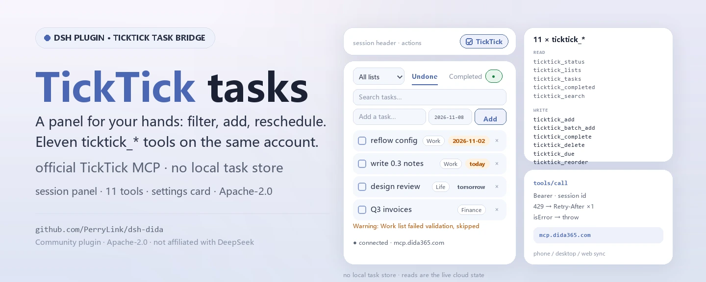
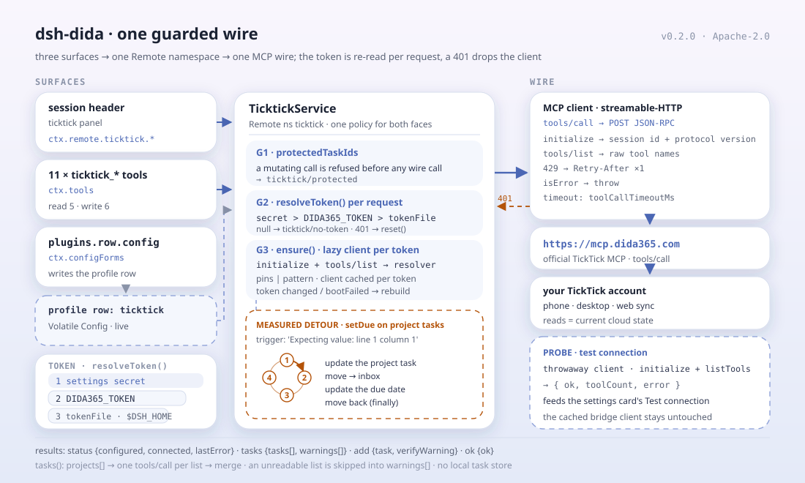

<div align="center">

<picture>
  <source media="(prefers-color-scheme: dark)" srcset="docs/assets/dsh-dida-hero-en-dark.webp">
  
</picture>

# dsh-dida

**Gestiona tus tareas de TickTick / Dida365 desde la cabecera de la sesión: filtra, añade, completa, reprograma, reordena arrastrando y deja el resto a once herramientas del agente.**

Un puente de tareas TickTick / Dida365 para DeepSeek Harness: un panel de tareas en la cabecera de sesión, once herramientas `ticktick_*`, una tarjeta de configuración en la página Plugins y un servicio Remote tipado, todo sobre el endpoint MCP oficial de TickTick.

[Instalación](#instalación-en-tres-pasos) · [Configuración](#configuración) · [FAQ](#faq) · [简体中文](README.md) · [English](README.en.md) · [Español](README.es.md) · [Português](README.pt.md) · [हिन्दी](README.hi.md)

[](LICENSE)
[](#compatibilidad)
[](https://www.npmjs.com/package/dsh-dida)
[](https://github.com/PerryLink/dsh-dida/actions/workflows/ci.yml)
[](#compatibilidad)

[](https://github.com/PerryLink/dsh-dida/stargazers)
[](https://www.npmjs.com/package/dsh-dida)
[](https://dshfind.com/plugins/PerryLink/dsh-dida?ref=badge)
[](https://dsh.market/)
[](https://gitee.com/perrylink/dsh-dida)

```sh
dsh plugin --profile <name> add dsh-dida
```

</div>

<sub>Plugin de la comunidad, no afiliado a DeepSeek. Repositorio canónico: <https://github.com/PerryLink/dsh-dida> (Gitee es un espejo). El paquete npm antiguo `@perrylink/dsh-ticktick` está obsoleto; instala `dsh-dida`.</sub>

## Qué es

`dsh-dida` lleva TickTick / Dida365 a DeepSeek Harness: la cabecera de sesión gana un panel `ticktick` para filtrar por lista, añadir rápido, completar, borrar con confirmación, fijar o limpiar fechas límite y reordenar arrastrando; sin token configurado, el panel ofrece la configuración en un solo paso. El modelo recibe once herramientas `ticktick_*` para listas, alta/edición/borrado, fechas, orden, completadas, búsqueda y alta por lotes, además de una tarjeta de configuración en la página Plugins. Toda lectura y escritura pasa por el endpoint MCP oficial de TickTick y aterriza en tu cuenta de TickTick en la nube, así que móvil, escritorio y web la ven: el plugin no guarda ninguna base de tareas local.

<div align="center">

<picture>
  <source media="(prefers-color-scheme: dark)" srcset="docs/assets/dsh-dida-flow-v5-dark.svg">
  
</picture>

</div>

## Instalación en tres pasos

1. **Instala** (elige un canal):

   ```sh
   # canal git (último main; equivalente a git+https://github.com/PerryLink/dsh-dida.git)
   dsh plugin --profile web add github:PerryLink/dsh-dida
   # canal npm (versiones publicadas; lib/ viaja en el tarball, sin permiso de build)
   dsh plugin --profile web add dsh-dida
   # código git fijado a un commit (pnpm te pedirá permitir el build prepare una vez)
   dsh plugin --profile web add "github:PerryLink/dsh-dida#<sha>"
   # canal tarball: pnpm pack en este repo y luego
   dsh plugin --profile web add ./dsh-dida-<version>.tgz
   # desarrollo local
   dsh plugin --profile web add link:/path/to/dsh-dida
   ```

   Reinicia `dsh web` (los plugins bundle se activan al reiniciar). La acción `ticktick` aparece en la cabecera de sesión; su página de configuración se abre desde el control **Configure** de la fila TickTick en la página Plugins.

2. **Configuración mínima** (los valores por defecto funcionan; elige una fuente de token):

   ```yaml
   - insert:
       - id: ticktick
         name: dsh-dida
         config:
           mcpUrl: https://mcp.dida365.com
   ```

   Prioridad del token, de mayor a menor: el campo secreto de la tarjeta de configuración, la variable de entorno `DIDA365_TOKEN` y un archivo de token (por defecto `$DSH_HOME/.ticktick-token`, una línea). Escribir el archivo activa el puente sin ningún cambio de configuración.

3. **Verifica que monta**:

   ```sh
   dsh --profile web --dump-config | grep -A2 'id: ticktick'
   ```

   ```
   > ticktick_lists
   Inbox (inbox)
   Work (hex1)
   ```

   Si `ticktick_lists` (o el panel de la cabecera) muestra tus listas, el token y el endpoint están vivos.

**Desinstalar**: `dsh plugin --profile web remove dsh-dida`. Reinicia `dsh web`. Todos los registros en ejecución (herramientas, panel, página de configuración, sección del prompt) se retiran con el plugin. El único residuo estático es el token en el documento de ajustes del usuario: límpialo antes con el botón **Clear credentials** de la página de configuración de TickTick (o elimina el archivo de token / la variable `DIDA365_TOKEN`) para desengancharte del todo. Para mantener el paquete instalado pero inactivo, desactiva la fila:

```yaml
- id: ticktick
  disabled: true
```

<details>
<summary>Instalar desde el mercado de DSH Desktop</summary>

Todos los plugins de PerryLink pueden explorarse en el mercado integrado de DSH Desktop: **Market → Sources → add source → pegar** `https://perrylink-dsh-catalog.perrylink.workers.dev/catalog-source.json` **→ seleccionarlo**. La instalación sigue pasando por la verificación de identidad npm del mercado y tu confirmación.

</details>

## Capacidades clave

`dsh-dida` convierte TickTick en un ciudadano de primera de la sesión: el panel es para tus dedos, las herramientas para el modelo y la tarjeta para el token; las tareas se quedan en la nube de TickTick.

- **Panel en la cabecera de sesión** — filtrar por lista (Todas + cada lista), alternar vistas pendientes/completadas, búsqueda de texto completo, añadir tareas con fecha de vencimiento opcional, completar, borrar con confirmación, fijar/limpiar fechas límite con etiquetas vencida/hoy/mañana y reordenar arrastrando en vistas pendientes de una sola lista. Un punto de estado muestra la conexión; sin token configurado, el panel ofrece la configuración del token en un solo paso.
- **Once herramientas del agente** — estado, listas, tareas, alta/completar/borrar, fechas límite, reordenar, completadas, búsqueda y alta por lotes; Code Mode obtiene `await tools.ticktick_*(args)` gratis.
- **Tarjeta de configuración** — página Plugins → la fila TickTick → **Configure**: token API (secreto), archivo de token, endpoint MCP (ajustes CN/Internacional), ids de tareas protegidos; los cuatro se aplican en vivo, sin reinicio. Además, botones **Test connection** y **Clear credentials**.
- **Relectura del token en vivo** — el token Bearer se relee en cada petición (secreto de la tarjeta > `DIDA365_TOKEN` > archivo de token, por defecto `$DSH_HOME/.ticktick-token`); un 401 reinicia el cliente para que un token rotado se active sin reiniciar.
- **Contorneos medidos** — el MCP de TickTick rechaza `update_task` para tareas dentro de proyectos normales (`Expecting value: line 1 column 1`); el puente reintenta con mover-a-bandeja → actualizar → devolver. Las listas que fallan la validación del servidor (datos históricos `repeatFrom: ''`) se omiten y se notifican como advertencias por lista, nunca se descartan en silencio.
- **Ids protegidos** — las operaciones de mutación rechazan tareas de la lista protegida antes de cualquier llamada de red.
- **Sincronización multidispositivo** — cada escritura va a la nube de TickTick, así que móvil, escritorio y web la ven; cada lectura trae el estado actual.

### Herramientas del agente

| Herramienta | Propósito |
|---|---|
| `ticktick_status` | estado de la conexión: token configurado, cliente conectado, endpoint, último error |
| `ticktick_lists` | todas las listas (proyectos), la Bandeja de entrada virtual incluida |
| `ticktick_tasks` | tareas pendientes: una lista o todas agregadas, con avisos por lista |
| `ticktick_add` | crear una tarea (lista, fecha ISO opcional) |
| `ticktick_complete` | completar una tarea (id de tarea + id de lista) |
| `ticktick_delete` | borrar una tarea (id de tarea + id de lista) |
| `ticktick_due` | fijar/limpiar una fecha límite (omitir la fecha para limpiar) |
| `ticktick_reorder` | asignar un nuevo sortOrder entero (las listas ordenan por sortOrder descendente) |
| `ticktick_completed` | tareas completadas en una ventana (30 días por defecto), opcionalmente una lista |
| `ticktick_search` | búsqueda de texto completo sobre tareas (la herramienta oficial de búsqueda) |
| `ticktick_batch_add` | crear varias tareas en una llamada |

### Arquitectura

```
panel del navegador ── ctx.remote.ticktick.* ──▶ TicktickService (Typert Remote)
página de configuración ── ctx.configForms ──▶ entrada de perfil "ticktick" (Config Volatile)
herramientas ──────── ctx.tools (ticktick_*) ─▶ el mismo servicio
                     │
                     ▼
         cliente MCP HTTP streamable mínimo
         (id de sesión, versión de protocolo, Retry-After)
                     │
                     ▼
         https://mcp.dida365.com  (MCP oficial de TickTick)
```

### Ejemplos

Son los puntos de entrada reales del plugin; instala una vez y llama a uno.

#### Ejemplo detallado

**Comando**

~~~sh
ticktick_lists
~~~

**Entrada**

~~~json
{}
~~~

**Salida**

~~~text
Inbox (inbox)
Work (hex1)
~~~

*Observed from `plugins/dsh-dida/src/tools.ts:107-109 (renderer); fixture/assertion at plugins/dsh-dida/tests/service.spec.ts:40-46,103-108`*

#### Rama de fallo

**Entrada**

~~~text
{"id":"t-guarded","projectId":"hex1"} (protectedTaskIds: ["t-guarded"])
~~~

**Salida**

~~~text
Error: task t-guarded is protected
~~~

*Observed from `plugins/dsh-dida/src/service.ts:344-349; plugins/dsh-dida/tests/service.spec.ts:158-163`*

#### Ejemplos breves

- `ticktick_tasks`
- `ticktick_add`

## Configuración

Todas las opciones son campos Schemastery `Config` (modificables desde cordis.yml). Una sobrescritura por id reemplaza la fila entera: repite cada clave que necesites. `cordis.patch.yml` documenta cada clave en línea.

Cómo obtener un token:

1. En la web de Dida365/TickTick, abre Perfil → Ajustes → Cuenta y seguridad → API token (un token con prefijo `dp_`).
2. Elige una de las tres fuentes de token (orden de prioridad): el campo secreto de la página de configuración de TickTick, la variable de entorno `DIDA365_TOKEN` o un archivo de token (por defecto `$DSH_HOME/.ticktick-token`, una línea).
3. Usa el botón **Test connection** de la tarjeta para verificar el token y **Clear credentials** para borrarlo.

Claves más usadas:

| Clave | Predeterminado | Significado |
|---|---|---|
| `token` | `''` | Token Bearer del campo secreto de la tarjeta de configuración; máxima prioridad |
| `tokenFile` | `''` | Archivo de texto con el token; vacío = `$DSH_HOME/.ticktick-token` |
| `mcpUrl` | `https://mcp.dida365.com` | Endpoint MCP de TickTick (el internacional no está verificado — ver Limitaciones conocidas) |
| `toolCallTimeoutMs` | `30000` | Plazo por tools/call en ms, 1000–300000 |
| `protectedTaskIds` | `[]` | Ids que toda mutación rechaza antes de cualquier llamada de red |
| `tools.*` | `''` cada uno | Nombres MCP fijados; `''` = descubrir por patrón |

<details>
<summary>Tabla de configuración completa (16 claves)</summary>

| Clave | Predeterminado | Significado |
|---|---|---|
| `token` | `''` | Token Bearer del campo secreto de la tarjeta de configuración; máxima prioridad |
| `tokenFile` | `''` | Archivo de texto con el token; vacío = `$DSH_HOME/.ticktick-token` |
| `mcpUrl` | `https://mcp.dida365.com` | Endpoint MCP de TickTick (el internacional no está verificado — ver Limitaciones conocidas) |
| `toolCallTimeoutMs` | `30000` | Plazo por tools/call en ms, 1000–300000 |
| `protectedTaskIds` | `[]` | Ids que toda mutación rechaza antes de cualquier llamada de red |
| `tools.projects` | `''` | Nombre fijado de la herramienta de proyectos; `''` = descubrir por patrón |
| `tools.tasks` | `''` | Nombre fijado de la herramienta de tareas pendientes; `''` = descubrir por patrón |
| `tools.create` | `''` | Nombre fijado de la herramienta de creación; `''` = descubrir por patrón |
| `tools.complete` | `''` | Nombre fijado de la herramienta de completado; `''` = descubrir por patrón |
| `tools.remove` | `''` | Nombre fijado de la herramienta de borrado; `''` = descubrir por patrón |
| `tools.update` | `''` | Nombre fijado de la herramienta de actualización; `''` = descubrir por patrón |
| `tools.move` | `''` | Nombre fijado de la herramienta de movimiento; `''` = descubrir por patrón |
| `tools.completed` | `''` | Nombre fijado de la herramienta de completadas; `''` = descubrir por patrón |
| `tools.search` | `''` | Nombre fijado de la herramienta de búsqueda; `''` = descubrir por patrón |
| `tools.getTask` | `''` | Nombre fijado de la herramienta de tarea por id; `''` = descubrir por patrón |
| `tools.batchAdd` | `''` | Nombre fijado de la herramienta de alta por lotes; `''` = descubrir por patrón |

</details>

Ejemplo de sobrescritura en tu patch de perfil:

```yaml
- insert:
    - id: ticktick
      name: dsh-dida
      config:
        mcpUrl: https://mcp.dida365.com
        toolCallTimeoutMs: 30000
        protectedTaskIds: [t-guarded]
```

## FAQ

<details>
<summary>¿Quién guarda el token y a dónde se envía?</summary>

El token tiene tres fuentes: el campo secreto de la tarjeta de configuración (guardado en el documento de ajustes del host), la variable de entorno `DIDA365_TOKEN` y un archivo de token (por defecto `$DSH_HOME/.ticktick-token`). El plugin lo relee en cada petición y solo lo envía como cabecera Bearer a `mcp.dida365.com`. El campo del token lleva `role('secret')`, así que el host lo redacta en cada respuesta de formulario, y la página de configuración escribe por rutas en vez de reconstruir la sección entera. La superficie `/api` es el gateway Typert estándar del harness; el plugin no levanta ningún servidor HTTP propio.

</details>

<details>
<summary>¿Fallan en silencio los problemas del servidor de TickTick?</summary>

Nada es silencioso. El MCP de TickTick rechaza `update_task` para tareas dentro de proyectos normales (`Expecting value: line 1 column 1`), así que el puente reintenta con mover-a-bandeja → actualizar → devolver. Las listas que fallan la validación del servidor (datos históricos `repeatFrom: ''`) se omiten y se muestran como advertencias por lista. Las negativas por id protegido ocurren antes de cualquier llamada de red, y `ticktick_status` informa del estado de conexión y del último error.

</details>

<details>
<summary>¿Compite con otros plugins por comandos, nombres de herramienta o slots?</summary>

No. Las once herramientas llevan el prefijo `ticktick_`; registra un único namespace Remote `ticktick`, una acción de cabecera de sesión (id `ticktick`) y una entrada `plugins.row.config`; no registra rutas `webServer` ni muta globales. El argumento punto por punto está en «Interoperabilidad con otros plugins DSH».

</details>

<details>
<summary>¿Cuánto coste de rendimiento supone?</summary>

No hay sondeo en segundo plano ni índice local de tareas: el panel y las herramientas hacen una llamada MCP bajo demanda y siempre leen el estado actual en la nube; cada llamada está limitada por `toolCallTimeoutMs` (30 segundos por defecto). El token se relee en cada petición y un 401 reinicia el cliente, así que rotar el token no exige reiniciar.

</details>

<details>
<summary>¿Qué pasa sin token o si el endpoint no responde?</summary>

El punto de estado del panel muestra la conexión, y sin token configurado el panel ofrece la configuración en un solo paso. Del lado del modelo, `ticktick_status` informa «token configurado / cliente conectado / endpoint / último error»; las demás herramientas propagan el error en lugar de inventar datos de tareas.

</details>

## Límites de seguridad

- **El token se queda local y solo va a TickTick.** Vive en el documento de ajustes del host o en tu propio archivo de token, y el plugin solo lo envía como cabecera Bearer a `mcp.dida365.com`. No expongas una instancia `dsh web` a internet público.
- **El campo secreto lo redacta el host.** El campo del token lleva `role('secret')`, así que el host lo elimina de cada respuesta de formulario; la página de configuración escribe por rutas y nunca reconstruye la sección, lo que borraría el token guardado.
- **Los ids protegidos van antes de la red.** Las tareas de `protectedTaskIds` se rechazan antes de que cualquier mutación haga una llamada de red.
- **Los fallos siguen visibles.** Un 401 reinicia el cliente; las listas que fallan la validación del servidor se muestran como advertencias por lista en vez de descartarse en silencio; `ticktick_status` expone el último error.
- **Los registros son efectos.** El servicio, las herramientas, la sección del prompt y el formulario de ajustes son efectos Cordis: descargar o recargar en caliente los retira.

## Permisos y datos

- **Permisos**: el manifest `dshWorkshop` declara `browser:local-storage`, `settings:read`, `settings:write` y `network:https://mcp.dida365.com`; `dsh.capabilities` lista `network:egress` y `tools:register`.
- **Datos**: las tareas y listas se quedan en tu cuenta de TickTick en la nube; el plugin no guarda ninguna base de tareas local y solo persiste el token y la configuración (documento de ajustes del host o tu archivo de token).
- **Superficie remota**: el panel pasa por `ctx.remote.ticktick.*` sobre el gateway Typert estándar del harness; el plugin no levanta ningún servidor HTTP propio.

## Limitaciones conocidas

- El endpoint internacional de TickTick **no está verificado**: `mcpUrl` apunta por defecto al endpoint CN y la URL MCP internacional no se ha probado.
- La vista de completadas, la búsqueda y el alta por lotes usan las herramientas MCP `list_completed_tasks_by_date`, `search` y `batch_add_tasks`; sus contratos vienen del catálogo publicado (stubs de `dida365-sdk`) y la **reverificación contra el endpoint real está pendiente**: ejecuta `probes/probe-queries.mjs` con un token real antes de darlos por verificados.
- El crash medido de `update_task` y los fallos de validación de listas son comportamientos del servidor; `probes/` los reverifica contra el endpoint real antes de un release (ejecuta con `DIDA365_TOKEN` exportado).
- La superficie `/api` que usa el panel es el gateway Typert estándar del harness; el token se guarda localmente (documento de ajustes o archivo de token) y se envía solo a los servidores de TickTick. No expongas una instancia `dsh web` a internet público.

## Interoperabilidad con otros plugins DSH

Comprobado contra el código y la declaración del bundle de este repositorio, `dsh-dida` mantiene deliberadamente estrecha su superficie de contacto:

- **Todos los nombres de herramienta llevan prefijo.** Las once herramientas son `ticktick_*`; no ocupa ningún nombre desnudo de una herramienta incluida ni de otro plugin.
- **Un solo namespace Remote.** La clave de servicio es `ticktick`; solo un plugin que reclamara el mismo namespace `ticktick` podría colisionar.
- **Dos slots de cliente con nombre.** La acción de cabecera de sesión `ticktick` (order 11) y la página de configuración `@perrylink/dsh-ticktick#ticktick`; la página solo aparece cuando existe su fila y no se registra ningún otro slot.
- **Sin prefijo `webServer`**, sin parchear prototipos, sin reescribir `process.env` y sin reemplazar el dispatcher global de fetch.
- **El patch solo inserta su propia fila.** `cordis.patch.yml` nunca sobrescribe el `config` de una fila incluida; una sobrescritura por id debe repetir la fila entera.
- **Conserva su propio cliente MCP mínimo.** `src/mcp.ts` no adopta la forma de supervisor de `@deepseek-ai/dsh-mcp-client` — ese paquete registra herramientas `mcp__<server>__<tool>` y reemplazaría los once nombres seleccionados; este plugin mantiene su transporte y sus contorneos medidos.

Por eso no compite con herramientas incluidas ni con otros plugins por nombres, rutas o estado global; el único namespace que hay que evitar es otro servicio `ticktick`.

## Compatibilidad

| Superficie | Estado |
|---|---|
| Harness | DeepSeek Harness **dsh-v0.2.1-alpha.1** (tag de GitHub). Línea npm fijada en `@deepseek-ai/dsh` **0.2.1-alpha.1** (peers `>=0.1.2-rc.1 <0.2.0 \|\| >=0.1.5-alpha.1 <0.2.0 \|\| >=0.1.6-0 <0.2.0 \|\| >=0.1.7-0 <0.2.0 \|\| >=0.2.0-0 <0.3.0 \|\| >=0.2.1-0 <0.3.0`). Verificado contra el checkout dsh-v0.2.1-alpha.1 (cadena completa de gates + smoke de instalación de perfil). |
| Node | `^22.19.0 \|\| >=24.0.0` |
| Plataformas | Donde corra DSH; el panel de tareas necesita un cliente web (`dsh web`) |
| Modelo | Cualquier modelo de texto con tool calling; no requiere capacidades extra |

## Ecosistema y calidad

- [Espejo de Gitee](https://gitee.com/perrylink/dsh-dida) (espejo sincronizado; GitHub es el canónico)
- [Página del plugin en dshfind](https://dshfind.com/plugins/PerryLink/dsh-dida) (instalaciones y ranking)
- [Informe de verificación de dsh-plugin-doctor](https://github.com/PerryLink/dsh-plugin-doctor#verified-徽章) (el informe al que apunta la insignia del repositorio)
- [DSH Market](https://dsh.market/) (listado)
- **Canal de la tienda 1024**: `npm i -g dsh1024` una vez y luego `dsh1024 plugin --profile web add dsh-dida` (cuenta para el ranking de instalaciones de [deepseek1024.com](https://deepseek1024.com))
- [Base de conocimiento del ecosistema](https://perrylink.github.io/dsh-plugin-guide/) — datos medidos, no marketing: guía de desarrollo de plugins · datos de selección · criterios de mantenimiento

## Desarrollo

```sh
pnpm install                                       # node ^22.19 || >=24
pnpm run typecheck && pnpm run typecheck:ci        # dos reglas: cara del checkout (con guarda; no verificable sin el checkout) + cara de la línea publicada
pnpm test                                          # vitest
pnpm run build                                     # scripts/prepare.mjs: declaraciones tsc + bundles tsdown
pnpm run verify:self-contained                     # las specs de dependencias se resuelven desde el registry
pnpm run verify:artifacts                          # archivos enviados presentes + artefactos importables
pnpm run check:readmes                             # consistencia de los README en cinco idiomas
pnpm pack                                          # el tarball publicado
```

La salida de build vive en `lib/`: `lib/index.js`, `lib/typert.host.js`, `lib/client.js` y `lib/types/`. Las imágenes del README se generan programáticamente con [`scripts/gen-readme-assets.py`](scripts/gen-readme-assets.py) (Pillow para el banner, SVG escrito a mano para el diagrama) y se pueden reejecutar sin riesgo: `python scripts/gen-readme-assets.py` escribe `docs/assets/dsh-dida-hero-{zh,en}-{light,dark}.webp` y `docs/assets/dsh-dida-flow-v5-{light,dark}.svg` (banner localizado, diagrama solo con tokens compartido por los cinco idiomas).

### Verificar contra el endpoint real

```sh
# PowerShell
$env:DIDA365_TOKEN='dp_...'
node probes/probe-bootstrap.mjs      # handshake + catálogo de herramientas
node probes/probe-crud.mjs           # ciclo crear/completar/borrar
node probes/probe-due.mjs            # fechas límite (+ desvío con un PROJECT_ID)
node probes/probe-reorder.mjs        # semántica de sortOrder
node probes/probe-queries.mjs        # descubrimiento del contrato P2 de consultas
```

Topics: `dsh`, `dsh-plugin`, `deepseek-harness`, `deepseek`, `cordis`, `ticktick`, `dida365`, `todo`, `task`, `mcp`, `widget`

## Familia y agradecimientos

Este proyecto forma parte de la familia de plugins de DeepSeek Harness de [PerryLink](https://github.com/PerryLink) (todos Apache-2.0). Si te resulta útil, **una estrella ayuda a que la siguiente persona lo encuentre** — no hay nada bloqueado tras ella.

- [@PerryLink](https://github.com/PerryLink) — creador y mantenedor: el panel de tareas de la cabecera de sesión, las once herramientas `ticktick_*`, la tarjeta de configuración, el servicio Remote tipado y la documentación en cinco idiomas.

<details>
<summary>Expandir todos los plugins</summary>

| Plugin | Estado |
|---|---|
| **[dsh-aqua-input-check](https://github.com/PerryLink/dsh-aqua-input-check)** |  |
| **[dsh-archive-check](https://github.com/PerryLink/dsh-archive-check)** |  |
| **[dsh-auto-review](https://github.com/PerryLink/dsh-auto-review)** |  |
| **[dsh-autotier](https://github.com/PerryLink/dsh-autotier)** | 🧊 CONGELADO — ver el README del repo |
| **[dsh-bid-ca-precheck](https://github.com/PerryLink/dsh-bid-ca-precheck)** |  |
| **[dsh-bid-qual-check](https://github.com/PerryLink/dsh-bid-qual-check)** |  |
| **[dsh-cert-mcp](https://github.com/PerryLink/dsh-cert-mcp)** | 🧊 CONGELADO — ver el README del repo |
| **[dsh-checkpoint-rewind](https://github.com/PerryLink/dsh-checkpoint-rewind)** |  |
| **[dsh-click](https://github.com/PerryLink/dsh-click)** |  |
| **[dsh-composer-history](https://github.com/PerryLink/dsh-composer-history)** |  |
| **[dsh-contract-stance](https://github.com/PerryLink/dsh-contract-stance)** |  |
| **[dsh-customs-doc-check](https://github.com/PerryLink/dsh-customs-doc-check)** |  |
| **[dsh-data-quality](https://github.com/PerryLink/dsh-data-quality)** | 🧊 CONGELADO — ver el README del repo |
| **[dsh-demurrage-ledger](https://github.com/PerryLink/dsh-demurrage-ledger)** |  |
| **[dsh-doublecheck](https://github.com/PerryLink/dsh-doublecheck)** |  |
| **[dsh-drill-script-check](https://github.com/PerryLink/dsh-drill-script-check)** |  |
| **[dsh-eia-guide-check](https://github.com/PerryLink/dsh-eia-guide-check)** |  |
| **[dsh-emergency-plan](https://github.com/PerryLink/dsh-emergency-plan)** |  |
| **[dsh-essay-rubric-check](https://github.com/PerryLink/dsh-essay-rubric-check)** |  |
| **[dsh-evidence-check](https://github.com/PerryLink/dsh-evidence-check)** |  |
| **[dsh-export-ctl-check](https://github.com/PerryLink/dsh-export-ctl-check)** |  |
| **[dsh-fast](https://github.com/PerryLink/dsh-fast)** |  |
| **[dsh-fmea-table-check](https://github.com/PerryLink/dsh-fmea-table-check)** |  |
| **[dsh-forecast-penalty](https://github.com/PerryLink/dsh-forecast-penalty)** |  |
| **[dsh-fund-research](https://github.com/PerryLink/dsh-fund-research)** |  |
| **[dsh-github](https://github.com/PerryLink/dsh-github)** |  |
| **[dsh-gongwen-flow-check](https://github.com/PerryLink/dsh-gongwen-flow-check)** |  |
| **[dsh-gongwen-word-check](https://github.com/PerryLink/dsh-gongwen-word-check)** |  |
| **[dsh-guard-plan-qc](https://github.com/PerryLink/dsh-guard-plan-qc)** |  |
| **[dsh-hazchem-check](https://github.com/PerryLink/dsh-hazchem-check)** |  |
| **[dsh-hazplan-check](https://github.com/PerryLink/dsh-hazplan-check)** |  |
| **[dsh-hidden-risk-map](https://github.com/PerryLink/dsh-hidden-risk-map)** |  |
| **[dsh-hs-classify](https://github.com/PerryLink/dsh-hs-classify)** |  |
| **[dsh-icd-rule-check](https://github.com/PerryLink/dsh-icd-rule-check)** |  |
| **[dsh-industry-research](https://github.com/PerryLink/dsh-industry-research)** |  |
| **[dsh-lawcite-adapter](https://github.com/PerryLink/dsh-lawcite-adapter)** |  |
| **[dsh-laya](https://github.com/PerryLink/dsh-laya)** |  |
| **[dsh-lc-doc-check](https://github.com/PerryLink/dsh-lc-doc-check)** |  |
| **[dsh-learning-gap-check](https://github.com/PerryLink/dsh-learning-gap-check)** |  |
| **[dsh-library](https://github.com/PerryLink/dsh-library)** |  |
| **[dsh-local-ai](https://github.com/PerryLink/dsh-local-ai)** |  |
| **[dsh-lsp-actions](https://github.com/PerryLink/dsh-lsp-actions)** |  |
| **[dsh-mask](https://github.com/PerryLink/dsh-mask)** |  |
| **[dsh-mcp-panel](https://github.com/PerryLink/dsh-mcp-panel)** |  |
| **[dsh-medrec-qc](https://github.com/PerryLink/dsh-medrec-qc)** |  |
| **[dsh-memento](https://github.com/PerryLink/dsh-memento)** | 🧊 CONGELADO — ver el README del repo |
| **[dsh-nsfc-form-check](https://github.com/PerryLink/dsh-nsfc-form-check)** |  |
| **[dsh-nurse-record-check](https://github.com/PerryLink/dsh-nurse-record-check)** |  |
| **[dsh-observe](https://github.com/PerryLink/dsh-observe)** |  |
| **[dsh-origin-rvc-check](https://github.com/PerryLink/dsh-origin-rvc-check)** |  |
| **[dsh-ota-review-check](https://github.com/PerryLink/dsh-ota-review-check)** |  |
| **[dsh-output-styles](https://github.com/PerryLink/dsh-output-styles)** |  |
| **[dsh-paper-doc-adapter](https://github.com/PerryLink/dsh-paper-doc-adapter)** |  |
| **[dsh-permission-rules](https://github.com/PerryLink/dsh-permission-rules)** |  |
| **[dsh-permit-report-check](https://github.com/PerryLink/dsh-permit-report-check)** |  |
| **[dsh-pipeline-check](https://github.com/PerryLink/dsh-pipeline-check)** |  |
| **[dsh-pleading-draft](https://github.com/PerryLink/dsh-pleading-draft)** |  |
| **[dsh-plugin-doctor](https://github.com/PerryLink/dsh-plugin-doctor)** | 🚫 RETIRADO (repo archivado) |
| **[dsh-plugin-guide](https://github.com/PerryLink/dsh-plugin-guide)** |  |
| **[dsh-plugin-kit](https://github.com/PerryLink/dsh-plugin-kit)** | 🚫 RETIRADO (repo archivado) |
| **[dsh-plugin-upgrade](https://github.com/PerryLink/dsh-plugin-upgrade)** | 🚫 RETIRADO (repo archivado) |
| **[dsh-policy-brief-draft](https://github.com/PerryLink/dsh-policy-brief-draft)** |  |
| **[dsh-power-loss-split](https://github.com/PerryLink/dsh-power-loss-split)** |  |
| **[dsh-power-ticket-check](https://github.com/PerryLink/dsh-power-ticket-check)** |  |
| **[dsh-ppap-check](https://github.com/PerryLink/dsh-ppap-check)** |  |
| **[dsh-protest-deadline](https://github.com/PerryLink/dsh-protest-deadline)** |  |
| **[dsh-railway-window](https://github.com/PerryLink/dsh-railway-window)** |  |
| **[dsh-repair-order-qc](https://github.com/PerryLink/dsh-repair-order-qc)** |  |
| **[dsh-research-report](https://github.com/PerryLink/dsh-research-report)** |  |
| **[dsh-review-reply-check](https://github.com/PerryLink/dsh-review-reply-check)** |  |
| **[dsh-rulefile-check](https://github.com/PerryLink/dsh-rulefile-check)** |  |
| **[dsh-safety-brief-check](https://github.com/PerryLink/dsh-safety-brief-check)** |  |
| **[dsh-score](https://github.com/PerryLink/dsh-score)** | 🧊 CONGELADO — ver el README del repo |
| **[dsh-session-sync](https://github.com/PerryLink/dsh-session-sync)** |  |
| **[dsh-site-log-check](https://github.com/PerryLink/dsh-site-log-check)** |  |
| **[dsh-skill-pack-security](https://github.com/PerryLink/dsh-skill-pack-security)** |  |
| **[dsh-soe-decision-check](https://github.com/PerryLink/dsh-soe-decision-check)** |  |
| **[dsh-soilwater-check](https://github.com/PerryLink/dsh-soilwater-check)** |  |
| **[dsh-sop-sync-check](https://github.com/PerryLink/dsh-sop-sync-check)** |  |
| **[dsh-spc-gbt-adapter](https://github.com/PerryLink/dsh-spc-gbt-adapter)** |  |
| **[dsh-talk](https://github.com/PerryLink/dsh-talk)** |  |
| **[dsh-tender-extract](https://github.com/PerryLink/dsh-tender-extract)** |  |
| **[dsh-tender-matrix](https://github.com/PerryLink/dsh-tender-matrix)** |  |
| **[dsh-test-drive](https://github.com/PerryLink/dsh-test-drive)** |  |
| **[dsh-dida](https://github.com/PerryLink/dsh-dida)** |  |
| **[dsh-translate](https://github.com/PerryLink/dsh-translate)** |  |
| **[dsh-warranty-calc](https://github.com/PerryLink/dsh-warranty-calc)** |  |
| **[dsh-budget](https://github.com/PerryLink/dsh-budget)** | 🧊 CONGELADO — ver el README del repo |
| **[dsh-claude-move](https://github.com/PerryLink/dsh-claude-move)** | 🧊 CONGELADO — ver el README del repo |
| **[dsh-defend](https://github.com/PerryLink/dsh-defend)** | 🧊 CONGELADO — ver el README del repo |
| **[dsh-draw](https://github.com/PerryLink/dsh-draw)** | 🧊 CONGELADO — ver el README del repo |
| **[dsh-reach](https://github.com/PerryLink/dsh-reach)** | 🧊 CONGELADO — ver el README del repo |
| **[dsh-background-agents](https://github.com/PerryLink/dsh-background-agents)** | 🚫 RETIRADO (repo archivado) |
| **[dsh-session-pin](https://github.com/PerryLink/dsh-session-pin)** | 🚫 RETIRADO (repo archivado) |
| **[dsh-team-rooms](https://github.com/PerryLink/dsh-team-rooms)** | 🚫 RETIRADO (repo archivado) |

</details>

## Licencia

[LICENSE](LICENSE) (Apache License 2.0) © 2026 dsh-dida contributors

<p align="center"><sub>Apache-2.0 · Plugin de la comunidad, no afiliado a DeepSeek.</sub></p>
