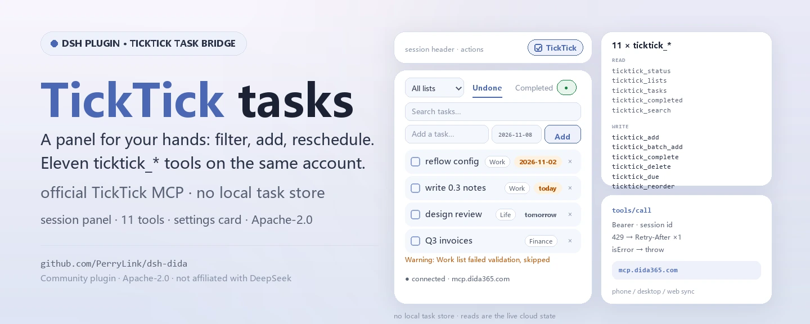
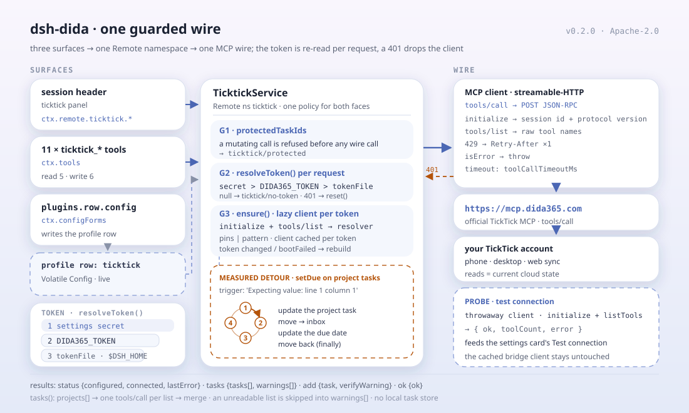

<div align="center">

<picture>
  <source media="(prefers-color-scheme: dark)" srcset="docs/assets/dsh-dida-hero-en-dark.webp">
  
</picture>

# dsh-dida

**अपने TickTick / Dida365 कार्य सीधे सत्र हेडर से संभालें — फ़िल्टर, त्वरित जोड़, पूर्ण, पुनर्निर्धारण, ड्रैग पुनःक्रम, और बाकी काम ग्यारह एजेंट टूल्स को सौंपें।**

DeepSeek Harness के लिए TickTick / Dida365 टास्क ब्रिज: सत्र-हेडर टास्क पैनल, ग्यारह `ticktick_*` टूल, प्लगइन पृष्ठ पर कॉन्फ़िगरेशन कार्ड और टाइप्ड Remote सेवा — सब आधिकारिक TickTick MCP एंडपॉइंट पर।

[इंस्टॉल](#तीन-चरणों-में-शुरुआत) · [कॉन्फ़िगरेशन](#कॉन्फ़िगरेशन) · [FAQ](#faq) · [简体中文](README.md) · [English](README.en.md) · [Español](README.es.md) · [Português](README.pt.md) · [हिन्दी](README.hi.md)

[](LICENSE)
[](#संगतता)
[](https://www.npmjs.com/package/dsh-dida)
[](https://github.com/PerryLink/dsh-dida/actions/workflows/ci.yml)
[](#संगतता)

[](https://github.com/PerryLink/dsh-dida/stargazers)
[](https://www.npmjs.com/package/dsh-dida)
[](https://dshfind.com/plugins/PerryLink/dsh-dida?ref=badge)
[](https://dsh.market/)
[](https://gitee.com/perrylink/dsh-dida)

```sh
dsh plugin --profile <name> add dsh-dida
```

</div>

<sub>सामुदायिक प्लगइन, DeepSeek से असंबद्ध। कैनोनिकल रिपॉज़िटरी: <https://github.com/PerryLink/dsh-dida> (Gitee एक मिरर है)। पुराना npm पैकेज `@perrylink/dsh-ticktick` अप्रचलित है; `dsh-dida` इंस्टॉल करें।</sub>

## यह क्या है

`dsh-dida` TickTick / Dida365 को DeepSeek Harness में लाता है: सत्र हेडर में एक `ticktick` पैनल जुड़ता है जिससे सूची के अनुसार फ़िल्टर, त्वरित जोड़, पूर्ण करना, पुष्टि के साथ हटाना, नियत तिथि सेट/साफ़ करना और ड्रैग पुनःक्रम किया जा सकता है; टोकन न हो तो पैनल एक-चरणीय सेटअप देता है। मॉडल को सूचियाँ, कार्य CRUD, नियत तिथियाँ, क्रम, पूर्ण कार्य, खोज और बैच जोड़ के लिए ग्यारह `ticktick_*` टूल मिलते हैं, साथ में प्लगइन पृष्ठ पर कॉन्फ़िगरेशन कार्ड। हर पढ़ना-लिखना आधिकारिक TickTick MCP एंडपॉइंट से होकर आपके TickTick क्लाउड खाते में जाता है, इसलिए फ़ोन/डेस्कटॉप/वेब ऐप उसे देखते हैं — प्लगइन अपना कोई स्थानीय टास्क स्टोर नहीं रखता।

<div align="center">

<picture>
  <source media="(prefers-color-scheme: dark)" srcset="docs/assets/dsh-dida-flow-v5-dark.svg">
  
</picture>

</div>

## तीन चरणों में शुरुआत

1. **इंस्टॉल करें** (एक चैनल चुनें):

   ```sh
   # git चैनल (नवीनतम main; git+https://github.com/PerryLink/dsh-dida.git के बराबर)
   dsh plugin --profile web add github:PerryLink/dsh-dida
   # npm चैनल (प्रकाशित रिलीज़; lib/ tarball में जाता है, build अनुमति नहीं चाहिए)
   dsh plugin --profile web add dsh-dida
   # git स्रोत किसी commit पर पिन (pnpm एक बार prepare build की अनुमति माँगेगा)
   dsh plugin --profile web add "github:PerryLink/dsh-dida#<sha>"
   # tarball चैनल: इस रेपो में pnpm pack करके
   dsh plugin --profile web add ./dsh-dida-<version>.tgz
   # स्थानीय डेवलपमेंट
   dsh plugin --profile web add link:/path/to/dsh-dida
   ```

   `dsh web` पुनः आरंभ करें (bundle प्लगइन रीस्टार्ट पर सक्रिय होते हैं)। `ticktick` क्रिया सत्र हेडर में दिखती है; उसका कॉन्फ़िगरेशन पृष्ठ प्लगइन पृष्ठ की TickTick पंक्ति पर **Configure** नियंत्रण से खुलता है।

2. **न्यूनतम कॉन्फ़िग** (डिफ़ॉल्ट काम करते हैं; एक टोकन स्रोत चुनें):

   ```yaml
   - insert:
       - id: ticktick
         name: dsh-dida
         config:
           mcpUrl: https://mcp.dida365.com
   ```

   टोकन प्राथमिकता, ऊँची से नीची: कॉन्फ़िगरेशन कार्ड का गुप्त क्षेत्र, `DIDA365_TOKEN` पर्यावरण चर, टोकन फ़ाइल (डिफ़ॉल्ट `$DSH_HOME/.ticktick-token`, एक पंक्ति)। फ़ाइल लिखने से ब्रिज बिना किसी कॉन्फ़िग बदलाव के सक्रिय हो जाता है।

3. **माउंट सत्यापित करें**:

   ```sh
   dsh --profile web --dump-config | grep -A2 'id: ticktick'
   ```

   ```
   > ticktick_lists
   Inbox (inbox)
   Work (hex1)
   ```

   यदि `ticktick_lists` (या हेडर पैनल) आपकी सूचियाँ दिखाता है, तो टोकन और एंडपॉइंट दोनों जीवित हैं।

**अनइंस्टॉल**: `dsh plugin --profile web remove dsh-dida`। `dsh web` पुनः आरंभ करें। सभी रनटाइम पंजीकरण (टूल, पैनल, कॉन्फ़िगरेशन पृष्ठ, prompt अनुभाग) प्लगइन के साथ हट जाते हैं। एकमात्र स्थैतिक अवशेष उपयोगकर्ता settings document में टोकन है — पूरी तरह अलग करने के लिए पहले TickTick कॉन्फ़िगरेशन पृष्ठ के **Clear credentials** बटन से उसे साफ़ करें (या टोकन फ़ाइल / `DIDA365_TOKEN` चर हटाएँ)। पैकेज इंस्टॉल रखकर निष्क्रिय करने के लिए पंक्ति को disabled करें:

```yaml
- id: ticktick
  disabled: true
```

<details>
<summary>DSH Desktop मार्केट से इंस्टॉल करें</summary>

सभी PerryLink प्लगइन DSH Desktop के अंतर्निहित मार्केट में ब्राउज़ किए जा सकते हैं: **Market → Sources → Add source → पेस्ट करें** `https://perrylink-dsh-catalog.perrylink.workers.dev/catalog-source.json` **→ चुनें**। इंस्टॉलेशन के लिए मार्केट की npm पहचान जाँच और आपकी पुष्टि आवश्यक रहती है।

</details>

## मुख्य क्षमताएँ

`dsh-dida` TickTick को सत्र का प्रथम-श्रेणी नागरिक बनाता है: पैनल उँगलियों के लिए, टूल मॉडल के लिए, कार्ड टोकन के लिए — कार्य स्वयं TickTick क्लाउड में रहते हैं।

- **सत्र-हेडर पैनल** — सूची के अनुसार फ़िल्टर (सभी + हर सूची), लंबित/पूर्ण दृश्य टॉगल, पूर्ण-पाठ खोज, वैकल्पिक नियत तिथि के साथ कार्य जोड़ना, पूर्ण करना, पुष्टि के साथ हटाना, अतिदेय/आज/कल चिप्स के साथ नियत तिथियाँ सेट/साफ़ करना, और एकल-सूची लंबित दृश्य में ड्रैग पुनःक्रम। एक स्थिति बिंदु कनेक्शन दिखाता है; टोकन कॉन्फ़िगर न हो तो पैनल एक-चरणीय टोकन सेटअप देता है।
- **ग्यारह एजेंट टूल** — स्थिति, सूचियाँ, कार्य, जोड़/पूर्ण/हटाना, नियत तिथियाँ, पुनःक्रम, पूर्ण कार्य, खोज और बैच जोड़; Code Mode को `await tools.ticktick_*(args)` मुफ़्त मिलता है।
- **कॉन्फ़िगरेशन कार्ड** — प्लगइन पृष्ठ → TickTick पंक्ति → **Configure**: API टोकन (गुप्त), टोकन फ़ाइल, MCP एंडपॉइंट (CN/अंतर्राष्ट्रीय प्रीसेट), संरक्षित कार्य ids; चारों बिना पुनरारंभ लाइव लागू होते हैं। साथ में **Test connection** और **Clear credentials** बटन।
- **लाइव टोकन पुनःपठन** — Bearer टोकन हर अनुरोध पर फिर पढ़ा जाता है (कार्ड गुप्त > `DIDA365_TOKEN` > टोकन फ़ाइल, डिफ़ॉल्ट `$DSH_HOME/.ticktick-token`); 401 क्लाइंट को रीसेट करता है ताकि बदला हुआ टोकन बिना पुनरारंभ सक्रिय हो जाए।
- **मापे गए कामकाज** — TickTick MCP सामान्य प्रोजेक्टों के कार्यों के लिए `update_task` अस्वीकार करता है (`Expecting value: line 1 column 1`); ब्रिज इनबॉक्स-में-ले-जाओ → अपडेट → वापस-ले-आओ के रास्ते से फिर कोशिश करता है। सर्वर-साइड सत्यापन में विफल सूचियाँ (ऐतिहासिक `repeatFrom: ''` डेटा) छोड़ दी जाती हैं और प्रति-सूची चेतावनी के रूप में सूचित होती हैं, चुपचाप कभी नहीं गिराई जातीं।
- **संरक्षित ids** — उत्परिवर्तन क्रियाएँ किसी भी नेटवर्क कॉल से पहले संरक्षित-सूची के कार्यों को मना करती हैं।
- **बहु-डिवाइस सिंक** — हर लेखन TickTick क्लाउड खाते पर जाता है, इसलिए फ़ोन/डेस्कटॉप/वेब ऐप उसे देखते हैं; हर पठन वर्तमान स्थिति लाता है।

### एजेंट टूल

| टूल | उद्देश्य |
|---|---|
| `ticktick_status` | कनेक्शन स्थिति: टोकन कॉन्फ़िगर, क्लाइंट जुड़ा, एंडपॉइंट, अंतिम त्रुटि |
| `ticktick_lists` | हर सूची (प्रोजेक्ट), वर्चुअल इनबॉक्स सहित |
| `ticktick_tasks` | लंबित कार्य: एक सूची या सभी समेकित, प्रति-सूची चेतावनियों के साथ |
| `ticktick_add` | कार्य बनाएँ (सूची, वैकल्पिक ISO नियत तिथि) |
| `ticktick_complete` | कार्य पूर्ण करें (कार्य id + सूची id) |
| `ticktick_delete` | कार्य हटाएँ (कार्य id + सूची id) |
| `ticktick_due` | नियत तिथि सेट/साफ़ करें (साफ़ करने के लिए तिथि छोड़ें) |
| `ticktick_reorder` | नया पूर्णांक sortOrder दें (सूचियाँ अवरोही sortOrder से क्रमित) |
| `ticktick_completed` | एक विंडो (डिफ़ॉल्ट 30 दिन) में पूर्ण किए कार्य, वैकल्पिक रूप से एक सूची |
| `ticktick_search` | कार्यों पर पूर्ण-पाठ खोज (आधिकारिक खोज टूल) |
| `ticktick_batch_add` | एक ही कॉल में कई कार्य बनाएँ |

### आर्किटेक्चर

```
ब्राउज़र पैनल ──────── ctx.remote.ticktick.* ──▶ TicktickService (Typert Remote)
कॉन्फ़िगरेशन पृष्ठ ── ctx.configForms ──▶ profile प्रविष्टि "ticktick" (Volatile Config)
एजेंट टूल ──────────── ctx.tools (ticktick_*) ─▶ वही सेवा
                     │
                     ▼
         न्यूनतम streamable-HTTP MCP क्लाइंट
         (session id, protocol version, Retry-After)
                     │
                     ▼
         https://mcp.dida365.com  (आधिकारिक TickTick MCP)
```

### उदाहरण

ये प्लगइन के वास्तविक प्रवेश बिंदु हैं; एक बार इंस्टॉल करके एक चलाएँ।

#### विस्तृत उदाहरण

**कमांड**

~~~sh
ticktick_lists
~~~

**इनपुट**

~~~json
{}
~~~

**आउटपुट**

~~~text
Inbox (inbox)
Work (hex1)
~~~

*Observed from `plugins/dsh-dida/src/tools.ts:107-109 (renderer); fixture/assertion at plugins/dsh-dida/tests/service.spec.ts:40-46,103-108`*

#### विफलता शाखा

**इनपुट**

~~~text
{"id":"t-guarded","projectId":"hex1"} (protectedTaskIds: ["t-guarded"])
~~~

**आउटपुट**

~~~text
Error: task t-guarded is protected
~~~

*Observed from `plugins/dsh-dida/src/service.ts:344-349; plugins/dsh-dida/tests/service.spec.ts:158-163`*

#### संक्षिप्त उदाहरण

- `ticktick_tasks`
- `ticktick_add`

## कॉन्फ़िगरेशन

सभी विकल्प Schemastery `Config` फ़ील्ड हैं (cordis.yml से बदले जा सकते हैं)। id-लक्षित ओवरराइड पूरी पंक्ति बदल देता है — जो कुंजियाँ चाहिए वे सब दोबारा लिखें। `cordis.patch.yml` हर कुंजी का इनलाइन दस्तावेज़ देता है।

टोकन कैसे लें:

1. Dida365/TickTick वेब ऐप में प्रोफ़ाइल → सेटिंग्स → खाता और सुरक्षा → API टोकन (`dp_` उपसर्ग वाला टोकन) खोलें।
2. तीन टोकन स्रोतों में से एक चुनें (प्राथमिकता क्रम): TickTick कॉन्फ़िगरेशन पृष्ठ का गुप्त क्षेत्र, `DIDA365_TOKEN` पर्यावरण चर, या टोकन फ़ाइल (डिफ़ॉल्ट `$DSH_HOME/.ticktick-token`, एक पंक्ति)।
3. टोकन सत्यापित करने के लिए कार्ड का **Test connection** बटन और उसे मिटाने के लिए **Clear credentials** बटन उपयोग करें।

सबसे अधिक उपयोग होने वाली कुंजियाँ:

| कुंजी | डिफ़ॉल्ट | अर्थ |
|---|---|---|
| `token` | `''` | कॉन्फ़िगरेशन कार्ड के गुप्त क्षेत्र का Bearer टोकन; सर्वोच्च प्राथमिकता |
| `tokenFile` | `''` | टोकन फ़ाइल का पथ; खाली = `$DSH_HOME/.ticktick-token` |
| `mcpUrl` | `https://mcp.dida365.com` | TickTick MCP एंडपॉइंट (अंतर्राष्ट्रीय अप्रमाणित — ज्ञात सीमाएँ देखें) |
| `toolCallTimeoutMs` | `30000` | प्रति tools/call समय-सीमा ms में, 1000–300000 |
| `protectedTaskIds` | `[]` | वे ids जिन्हें हर उत्परिवर्तन नेटवर्क कॉल से पहले मना करता है |
| `tools.*` | प्रत्येक `''` | स्थिर MCP टूल नाम; `''` = पैटर्न से खोजना |

<details>
<summary>पूर्ण कॉन्फ़िगरेशन तालिका (16 कुंजियाँ)</summary>

| कुंजी | डिफ़ॉल्ट | अर्थ |
|---|---|---|
| `token` | `''` | कॉन्फ़िगरेशन कार्ड के गुप्त क्षेत्र का Bearer टोकन; सर्वोच्च प्राथमिकता |
| `tokenFile` | `''` | टोकन फ़ाइल का पथ; खाली = `$DSH_HOME/.ticktick-token` |
| `mcpUrl` | `https://mcp.dida365.com` | TickTick MCP एंडपॉइंट (अंतर्राष्ट्रीय अप्रमाणित — ज्ञात सीमाएँ देखें) |
| `toolCallTimeoutMs` | `30000` | प्रति tools/call समय-सीमा ms में, 1000–300000 |
| `protectedTaskIds` | `[]` | वे ids जिन्हें हर उत्परिवर्तन नेटवर्क कॉल से पहले मना करता है |
| `tools.projects` | `''` | प्रोजेक्ट-सूची टूल का स्थिर नाम; `''` = पैटर्न से खोजना |
| `tools.tasks` | `''` | लंबित-कार्य टूल का स्थिर नाम; `''` = पैटर्न से खोजना |
| `tools.create` | `''` | कार्य-निर्माण टूल का स्थिर नाम; `''` = पैटर्न से खोजना |
| `tools.complete` | `''` | कार्य-पूर्णता टूल का स्थिर नाम; `''` = पैटर्न से खोजना |
| `tools.remove` | `''` | कार्य-हटाने टूल का स्थिर नाम; `''` = पैटर्न से खोजना |
| `tools.update` | `''` | कार्य-अद्यतन टूल का स्थिर नाम; `''` = पैटर्न से खोजना |
| `tools.move` | `''` | कार्य-स्थानांतरण टूल का स्थिर नाम; `''` = पैटर्न से खोजना |
| `tools.completed` | `''` | पूर्ण-कार्य क्वेरी टूल का स्थिर नाम; `''` = पैटर्न से खोजना |
| `tools.search` | `''` | खोज टूल का स्थिर नाम; `''` = पैटर्न से खोजना |
| `tools.getTask` | `''` | id से कार्य लाने वाले टूल का स्थिर नाम; `''` = पैटर्न से खोजना |
| `tools.batchAdd` | `''` | बैच-जोड़ टूल का स्थिर नाम; `''` = पैटर्न से खोजना |

</details>

आपके प्रोफ़ाइल पैच में ओवरराइड उदाहरण:

```yaml
- insert:
    - id: ticktick
      name: dsh-dida
      config:
        mcpUrl: https://mcp.dida365.com
        toolCallTimeoutMs: 30000
        protectedTaskIds: [t-guarded]
```

## FAQ

<details>
<summary>टोकन कौन रखता है, और वह कहाँ भेजा जाता है?</summary>

टोकन के तीन स्रोत हैं: कॉन्फ़िगरेशन कार्ड का गुप्त क्षेत्र (host के settings document में संग्रहीत), `DIDA365_TOKEN` पर्यावरण चर और टोकन फ़ाइल (डिफ़ॉल्ट `$DSH_HOME/.ticktick-token`)। प्लगइन इसे हर अनुरोध पर फिर पढ़ता है और केवल Bearer हेडर के रूप में `mcp.dida365.com` को भेजता है। कार्ड का टोकन क्षेत्र `role('secret')` रखता है, इसलिए host हर फ़ॉर्म प्रतिक्रिया से उसे हटा देता है, और कॉन्फ़िगरेशन पृष्ठ पूरे अनुभाग को फिर से बनाने के बजाय पथ-आधारित लेखन करता है। `/api` सतह harness का मानक Typert गेटवे है; प्लगइन अपना कोई HTTP सर्वर नहीं चलाता।

</details>

<details>
<summary>क्या TickTick सर्वर की विफलताएँ चुपचाप होती हैं?</summary>

कुछ भी मौन नहीं है। TickTick MCP सामान्य प्रोजेक्टों के कार्यों के लिए `update_task` अस्वीकार करता है (`Expecting value: line 1 column 1`), इसलिए ब्रिज इनबॉक्स-में-ले-जाओ → अपडेट → वापस-ले-आओ से फिर कोशिश करता है। सर्वर-साइड सत्यापन में विफल सूचियाँ (ऐतिहासिक `repeatFrom: ''` डेटा) छोड़ी जाती हैं और प्रति-सूची चेतावनी के रूप में दिखाई जाती हैं। संरक्षित-id अस्वीकृतियाँ किसी भी नेटवर्क कॉल से पहले होती हैं, और `ticktick_status` कनेक्शन स्थिति व अंतिम त्रुटि बताता है।

</details>

<details>
<summary>क्या यह अन्य प्लगइनों से कमांड, टूल नाम या स्लॉट के लिए टकराता है?</summary>

नहीं। ग्यारहों टूल `ticktick_` उपसर्ग रखते हैं; यह एक `ticktick` Remote namespace, एक सत्र-हेडर क्रिया (id `ticktick`) और एक `plugins.row.config` प्रविष्टि पंजीकृत करता है; कोई `webServer` रूट पंजीकृत नहीं करता और ग्लोबल नहीं बदलता। बिंदु-दर-बिंदु तर्क «अन्य DSH प्लगइनों के साथ इंटरऑपरेबिलिटी» में है।

</details>

<details>
<summary>प्रदर्शन लागत कितनी है?</summary>

कोई पृष्ठभूमि पोलिंग नहीं और कोई स्थानीय टास्क इंडेक्स नहीं: पैनल और टूल माँग पर एक MCP कॉल करते हैं और हमेशा क्लाउड की वर्तमान स्थिति पढ़ते हैं; एक कॉल की सीमा `toolCallTimeoutMs` (डिफ़ॉल्ट 30 सेकंड) है। टोकन हर अनुरोध पर फिर पढ़ा जाता है और 401 क्लाइंट को रीसेट करता है, इसलिए टोकन बदलने पर पुनरारंभ नहीं चाहिए।

</details>

<details>
<summary>टोकन न हो या एंडपॉइंट न पहुँचे तो क्या होता है?</summary>

पैनल का स्थिति बिंदु कनेक्शन दिखाता है, और टोकन कॉन्फ़िगर न हो तो पैनल एक-चरणीय सेटअप देता है। मॉडल की ओर से `ticktick_status` «टोकन कॉन्फ़िगर / क्लाइंट जुड़ा / एंडपॉइंट / अंतिम त्रुटि» बताता है; बाकी टूल त्रुटि आगे बढ़ाते हैं, कार्य डेटा गढ़ते नहीं।

</details>

## सुरक्षा सीमाएँ

- **टोकन स्थानीय रहता है और केवल TickTick को जाता है।** वह host के settings document या आपकी अपनी टोकन फ़ाइल में रहता है, और प्लगइन उसे केवल Bearer हेडर के रूप में `mcp.dida365.com` को भेजता है। `dsh web` इंस्टेंस को सार्वजनिक इंटरनेट पर उजागर न करें।
- **गुप्त क्षेत्र को host हटाता है।** टोकन क्षेत्र `role('secret')` रखता है, इसलिए host उसे हर फ़ॉर्म प्रतिक्रिया से हटा देता है; कॉन्फ़िगरेशन पृष्ठ पथ-आधारित लेखन करता है और अनुभाग को कभी फिर से नहीं बनाता, जिससे संग्रहीत टोकन मिट जाता।
- **संरक्षित ids नेटवर्क से पहले।** `protectedTaskIds` के कार्य किसी भी उत्परिवर्तन के नेटवर्क कॉल से पहले मना कर दिए जाते हैं।
- **विफलताएँ दिखती रहती हैं।** 401 क्लाइंट को रीसेट करता है; सर्वर-साइड सत्यापन में विफल सूचियाँ चुपचाप गिराने के बजाय प्रति-सूची चेतावनी के रूप में दिखती हैं; `ticktick_status` अंतिम त्रुटि दिखाता है।
- **पंजीकरण प्रभाव हैं।** सेवा, टूल, prompt अनुभाग और settings फ़ॉर्म सभी Cordis effects हैं — अनलोड या हॉट-रिलोड उन्हें हटा देता है।

## अनुमतियाँ और डेटा

- **अनुमतियाँ**: `dshWorkshop` manifest `browser:local-storage`, `settings:read`, `settings:write` और `network:https://mcp.dida365.com` घोषित करता है; `dsh.capabilities` में `network:egress` और `tools:register` हैं।
- **डेटा**: कार्य और सूचियाँ आपके TickTick क्लाउड खाते में रहते हैं; प्लगइन कोई स्थानीय टास्क स्टोर नहीं रखता और केवल टोकन व कॉन्फ़िगरेशन सहेजता है (host settings document या आपकी टोकन फ़ाइल)।
- **रिमोट सतह**: पैनल `ctx.remote.ticktick.*` से harness के मानक Typert गेटवे पर जाता है; प्लगइन अपना कोई HTTP सर्वर नहीं चलाता।

## ज्ञात सीमाएँ

- अंतर्राष्ट्रीय TickTick एंडपॉइंट **अप्रमाणित है**: `mcpUrl` डिफ़ॉल्ट रूप से CN एंडपॉइंट पर जाता है और अंतर्राष्ट्रीय MCP URL की जाँच नहीं हुई है।
- पूर्ण दृश्य, खोज और बैच जोड़ MCP टूल `list_completed_tasks_by_date`, `search` और `batch_add_tasks` पर चलते हैं; इनके वायर अनुबंध प्रकाशित कैटलॉग (`dida365-sdk` stubs) से आते हैं और लाइव एंडपॉइंट के विरुद्ध **पुनः-सत्यापन लंबित** है — इन्हें सत्यापित मानने से पहले असली टोकन के साथ `probes/probe-queries.mjs` चलाएँ।
- मापा गया `update_task` क्रैश और सूची-सत्यापन विफलताएँ सर्वर-साइड व्यवहार हैं; `probes/` हर release से पहले उन्हें लाइव एंडपॉइंट के विरुद्ध फिर सत्यापित करता है (`DIDA365_TOKEN` निर्यात करके चलाएँ)।
- पैनल जो `/api` सतह उपयोग करता है वह मानक harness Typert गेटवे है; टोकन स्थानीय रूप से संग्रहीत रहता है (settings document या टोकन फ़ाइल) और केवल TickTick के अपने सर्वरों को भेजा जाता है। `dsh web` इंस्टेंस को सार्वजनिक इंटरनेट पर उजागर न करें।

## अन्य DSH प्लगइनों के साथ इंटरऑपरेबिलिटी

इस रेपो के कोड और bundle घोषणा के विरुद्ध जाँचा गया, `dsh-dida` अपनी संपर्क सतह जानबूझकर संकीर्ण रखता है:

- **हर टूल नाम उपसर्ग युक्त है।** ग्यारहों टूल `ticktick_*` हैं; किसी अंतर्निहित टूल या अन्य प्लगइन का कोई नंगा नाम नहीं लिया जाता।
- **केवल एक Remote namespace।** सेवा कुंजी `ticktick` है; केवल वही प्लगइन टकरा सकता है जो वही `ticktick` namespace दावा करे।
- **दो नामित क्लाइंट स्लॉट।** सत्र-हेडर क्रिया `ticktick` (order 11) और प्लगइन-पंक्ति कॉन्फ़िगरेशन पृष्ठ `@perrylink/dsh-ticktick#ticktick`; पृष्ठ केवल तब दिखता है जब उसकी पंक्ति हो, और कोई अन्य slot पंजीकृत नहीं होता।
- **कोई `webServer` उपसर्ग नहीं**, प्रोटोटाइप पैच नहीं, `process.env` पुनर्लेखन नहीं, और वैश्विक fetch dispatcher का प्रतिस्थापन नहीं।
- **patch केवल अपनी पंक्ति insert करता है।** `cordis.patch.yml` किसी अंतर्निहित पंक्ति का `config` कभी ओवरराइड नहीं करता; id-लक्षित ओवरराइड में पूरी पंक्ति दोबारा लिखनी होती है।
- **यह अपना न्यूनतम MCP क्लाइंट रखता है।** `src/mcp.ts` `@deepseek-ai/dsh-mcp-client` का supervisor रूप नहीं अपनाता — वह पैकेज `mcp__<server>__<tool>` टूल पंजीकृत करता और इन ग्यारह चुने हुए नामों को बदल देता; यह प्लगइन अपना transport और मापे गए रास्ते रखता है।

इसलिए यह अंतर्निहित टूल या अन्य प्लगइनों से नाम, रूट या वैश्विक स्थिति के लिए नहीं लड़ता; केवल एक ही namespace से बचना है — दूसरा `ticktick` सेवा।

## संगतता

| सतह | स्थिति |
|---|---|
| Harness | DeepSeek Harness **dsh-v0.2.1-alpha.1** (GitHub tag)। npm डिपेंडेंसी लाइन `@deepseek-ai/dsh` **0.2.1-alpha.1** पर पिन (peers `>=0.1.2-rc.1 <0.2.0 \|\| >=0.1.5-alpha.1 <0.2.0 \|\| >=0.1.6-0 <0.2.0 \|\| >=0.1.7-0 <0.2.0 \|\| >=0.2.0-0 <0.3.0 \|\| >=0.2.1-0 <0.3.0`)। dsh-v0.2.1-alpha.1 checkout के विरुद्ध सत्यापित (पूर्ण gate chain + profile install smoke)। |
| Node | `^22.19.0 \|\| >=24.0.0` |
| प्लेटफ़ॉर्म | जहाँ DSH चले; टास्क पैनल के लिए वेब क्लाइंट (`dsh web`) चाहिए |
| मॉडल | tool calling वाला कोई भी टेक्स्ट मॉडल; कोई अतिरिक्त क्षमता आवश्यक नहीं |

## इकोसिस्टम और गुणवत्ता

- [Gitee मिरर](https://gitee.com/perrylink/dsh-dida) (सिंक मिरर; GitHub कैनोनिकल है)
- [dshfind प्लगइन पेज](https://dshfind.com/plugins/PerryLink/dsh-dida) (इंस्टॉल और रैंकिंग)
- [dsh-plugin-doctor सत्यापन रिपोर्ट](https://github.com/PerryLink/dsh-plugin-doctor#verified-徽章) (वही रिपोर्ट जिसकी ओर रेपो का बैज इशारा करता है)
- [DSH Market](https://dsh.market/) (सूचीबद्ध)
- **1024 स्टोर चैनल**: एक बार `npm i -g dsh1024`, फिर `dsh1024 plugin --profile web add dsh-dida` ([deepseek1024.com](https://deepseek1024.com) इंस्टॉल रैंकिंग में गिना जाता है)
- [इकोसिस्टम नॉलेज बेस](https://perrylink.github.io/dsh-plugin-guide/) — मापे गए आँकड़े, मार्केटिंग नहीं: डेवलपमेंट गाइड · चयन डेटा · रखरखाव मानदंड

## डेवलपमेंट

```sh
pnpm install                                       # node ^22.19 || >=24
pnpm run typecheck && pnpm run typecheck:ci        # दो मापदंड: checkout फ़ेस (गार्डेड; checkout बिना सत्यापनयोग्य नहीं) + प्रकाशित-लाइन फ़ेस
pnpm test                                          # vitest
pnpm run build                                     # scripts/prepare.mjs: tsc घोषणाएँ + tsdown bundles
pnpm run verify:self-contained                     # निर्भरता स्पेक registry से हल होती हैं
pnpm run verify:artifacts                          # भेजी गई फ़ाइलें मौजूद + आर्टिफ़ैक्ट इम्पोर्ट योग्य
pnpm run check:readmes                             # पाँच-भाषा README संगति
pnpm pack                                          # प्रकाशित tarball
```

build आउटपुट `lib/` में है: `lib/index.js`, `lib/typert.host.js`, `lib/client.js` और `lib/types/`। README की छवियाँ [`scripts/gen-readme-assets.py`](scripts/gen-readme-assets.py) (hero के लिए Pillow, संरचना चित्र के लिए हाथ से लिखा SVG) से प्रोग्रामेटिक रूप में बनती हैं और सुरक्षित रूप से दोबारा चलाई जा सकती हैं: `python scripts/gen-readme-assets.py` `docs/assets/dsh-dida-hero-{zh,en}-{light,dark}.webp` और `docs/assets/dsh-dida-flow-v5-{light,dark}.svg` लिखता है (hero स्थानीयकृत, संरचना चित्र केवल कमांड टोकन, पाँचों भाषाओं में साझा)।

### लाइव एंडपॉइंट के विरुद्ध सत्यापन

```sh
# PowerShell
$env:DIDA365_TOKEN='dp_...'
node probes/probe-bootstrap.mjs      # handshake + टूल कैटलॉग
node probes/probe-crud.mjs           # बनाओ/पूर्ण/हटाओ राउंड ट्रिप
node probes/probe-due.mjs            # नियत तिथियाँ (+ PROJECT_ID के साथ detour)
node probes/probe-reorder.mjs        # sortOrder शब्दार्थ
node probes/probe-queries.mjs        # P2 क्वेरी-टूल अनुबंध खोज
```

Topics: `dsh`, `dsh-plugin`, `deepseek-harness`, `deepseek`, `cordis`, `ticktick`, `dida365`, `todo`, `task`, `mcp`, `widget`

## परिवार और आभार

यह प्रोजेक्ट [PerryLink](https://github.com/PerryLink) के DeepSeek Harness प्लगइन परिवार का हिस्सा है (सभी Apache-2.0)। अगर यह उपयोगी लगे, तो **एक स्टार अगले व्यक्ति को इसे खोजने में मदद करता है** — इसके पीछे कुछ भी लॉक नहीं है।

- [@PerryLink](https://github.com/PerryLink) — निर्माता और रखरखावकर्ता: सत्र-हेडर टास्क पैनल, ग्यारह `ticktick_*` टूल, कॉन्फ़िगरेशन कार्ड, टाइप्ड Remote सेवा और पाँच-भाषा दस्तावेज़।

<details>
<summary>सभी प्लगइन खोलें</summary>

| प्लगइन | स्थिति |
|---|---|
| **[dsh-aqua-input-check](https://github.com/PerryLink/dsh-aqua-input-check)** |  |
| **[dsh-archive-check](https://github.com/PerryLink/dsh-archive-check)** |  |
| **[dsh-auto-review](https://github.com/PerryLink/dsh-auto-review)** |  |
| **[dsh-autotier](https://github.com/PerryLink/dsh-autotier)** | 🧊 फ़्रोज़न — रेपो README देखें |
| **[dsh-bid-ca-precheck](https://github.com/PerryLink/dsh-bid-ca-precheck)** |  |
| **[dsh-bid-qual-check](https://github.com/PerryLink/dsh-bid-qual-check)** |  |
| **[dsh-cert-mcp](https://github.com/PerryLink/dsh-cert-mcp)** | 🧊 फ़्रोज़न — रेपो README देखें |
| **[dsh-checkpoint-rewind](https://github.com/PerryLink/dsh-checkpoint-rewind)** |  |
| **[dsh-click](https://github.com/PerryLink/dsh-click)** |  |
| **[dsh-composer-history](https://github.com/PerryLink/dsh-composer-history)** |  |
| **[dsh-contract-stance](https://github.com/PerryLink/dsh-contract-stance)** |  |
| **[dsh-customs-doc-check](https://github.com/PerryLink/dsh-customs-doc-check)** |  |
| **[dsh-data-quality](https://github.com/PerryLink/dsh-data-quality)** | 🧊 फ़्रोज़न — रेपो README देखें |
| **[dsh-demurrage-ledger](https://github.com/PerryLink/dsh-demurrage-ledger)** |  |
| **[dsh-doublecheck](https://github.com/PerryLink/dsh-doublecheck)** |  |
| **[dsh-drill-script-check](https://github.com/PerryLink/dsh-drill-script-check)** |  |
| **[dsh-eia-guide-check](https://github.com/PerryLink/dsh-eia-guide-check)** |  |
| **[dsh-emergency-plan](https://github.com/PerryLink/dsh-emergency-plan)** |  |
| **[dsh-essay-rubric-check](https://github.com/PerryLink/dsh-essay-rubric-check)** |  |
| **[dsh-evidence-check](https://github.com/PerryLink/dsh-evidence-check)** |  |
| **[dsh-export-ctl-check](https://github.com/PerryLink/dsh-export-ctl-check)** |  |
| **[dsh-fast](https://github.com/PerryLink/dsh-fast)** |  |
| **[dsh-fmea-table-check](https://github.com/PerryLink/dsh-fmea-table-check)** |  |
| **[dsh-forecast-penalty](https://github.com/PerryLink/dsh-forecast-penalty)** |  |
| **[dsh-fund-research](https://github.com/PerryLink/dsh-fund-research)** |  |
| **[dsh-github](https://github.com/PerryLink/dsh-github)** |  |
| **[dsh-gongwen-flow-check](https://github.com/PerryLink/dsh-gongwen-flow-check)** |  |
| **[dsh-gongwen-word-check](https://github.com/PerryLink/dsh-gongwen-word-check)** |  |
| **[dsh-guard-plan-qc](https://github.com/PerryLink/dsh-guard-plan-qc)** |  |
| **[dsh-hazchem-check](https://github.com/PerryLink/dsh-hazchem-check)** |  |
| **[dsh-hazplan-check](https://github.com/PerryLink/dsh-hazplan-check)** |  |
| **[dsh-hidden-risk-map](https://github.com/PerryLink/dsh-hidden-risk-map)** |  |
| **[dsh-hs-classify](https://github.com/PerryLink/dsh-hs-classify)** |  |
| **[dsh-icd-rule-check](https://github.com/PerryLink/dsh-icd-rule-check)** |  |
| **[dsh-industry-research](https://github.com/PerryLink/dsh-industry-research)** |  |
| **[dsh-lawcite-adapter](https://github.com/PerryLink/dsh-lawcite-adapter)** |  |
| **[dsh-laya](https://github.com/PerryLink/dsh-laya)** |  |
| **[dsh-lc-doc-check](https://github.com/PerryLink/dsh-lc-doc-check)** |  |
| **[dsh-learning-gap-check](https://github.com/PerryLink/dsh-learning-gap-check)** |  |
| **[dsh-library](https://github.com/PerryLink/dsh-library)** |  |
| **[dsh-local-ai](https://github.com/PerryLink/dsh-local-ai)** |  |
| **[dsh-lsp-actions](https://github.com/PerryLink/dsh-lsp-actions)** |  |
| **[dsh-mask](https://github.com/PerryLink/dsh-mask)** |  |
| **[dsh-mcp-panel](https://github.com/PerryLink/dsh-mcp-panel)** |  |
| **[dsh-medrec-qc](https://github.com/PerryLink/dsh-medrec-qc)** |  |
| **[dsh-memento](https://github.com/PerryLink/dsh-memento)** | 🧊 फ़्रोज़न — रेपो README देखें |
| **[dsh-nsfc-form-check](https://github.com/PerryLink/dsh-nsfc-form-check)** |  |
| **[dsh-nurse-record-check](https://github.com/PerryLink/dsh-nurse-record-check)** |  |
| **[dsh-observe](https://github.com/PerryLink/dsh-observe)** |  |
| **[dsh-origin-rvc-check](https://github.com/PerryLink/dsh-origin-rvc-check)** |  |
| **[dsh-ota-review-check](https://github.com/PerryLink/dsh-ota-review-check)** |  |
| **[dsh-output-styles](https://github.com/PerryLink/dsh-output-styles)** |  |
| **[dsh-paper-doc-adapter](https://github.com/PerryLink/dsh-paper-doc-adapter)** |  |
| **[dsh-permission-rules](https://github.com/PerryLink/dsh-permission-rules)** |  |
| **[dsh-permit-report-check](https://github.com/PerryLink/dsh-permit-report-check)** |  |
| **[dsh-pipeline-check](https://github.com/PerryLink/dsh-pipeline-check)** |  |
| **[dsh-pleading-draft](https://github.com/PerryLink/dsh-pleading-draft)** |  |
| **[dsh-plugin-doctor](https://github.com/PerryLink/dsh-plugin-doctor)** | 🚫 रिटायर्ड (रेपो संग्रहीत) |
| **[dsh-plugin-guide](https://github.com/PerryLink/dsh-plugin-guide)** |  |
| **[dsh-plugin-kit](https://github.com/PerryLink/dsh-plugin-kit)** | 🚫 रिटायर्ड (रेपो संग्रहीत) |
| **[dsh-plugin-upgrade](https://github.com/PerryLink/dsh-plugin-upgrade)** | 🚫 रिटायर्ड (रेपो संग्रहीत) |
| **[dsh-policy-brief-draft](https://github.com/PerryLink/dsh-policy-brief-draft)** |  |
| **[dsh-power-loss-split](https://github.com/PerryLink/dsh-power-loss-split)** |  |
| **[dsh-power-ticket-check](https://github.com/PerryLink/dsh-power-ticket-check)** |  |
| **[dsh-ppap-check](https://github.com/PerryLink/dsh-ppap-check)** |  |
| **[dsh-protest-deadline](https://github.com/PerryLink/dsh-protest-deadline)** |  |
| **[dsh-railway-window](https://github.com/PerryLink/dsh-railway-window)** |  |
| **[dsh-repair-order-qc](https://github.com/PerryLink/dsh-repair-order-qc)** |  |
| **[dsh-research-report](https://github.com/PerryLink/dsh-research-report)** |  |
| **[dsh-review-reply-check](https://github.com/PerryLink/dsh-review-reply-check)** |  |
| **[dsh-rulefile-check](https://github.com/PerryLink/dsh-rulefile-check)** |  |
| **[dsh-safety-brief-check](https://github.com/PerryLink/dsh-safety-brief-check)** |  |
| **[dsh-score](https://github.com/PerryLink/dsh-score)** | 🧊 फ़्रोज़न — रेपो README देखें |
| **[dsh-session-sync](https://github.com/PerryLink/dsh-session-sync)** |  |
| **[dsh-site-log-check](https://github.com/PerryLink/dsh-site-log-check)** |  |
| **[dsh-skill-pack-security](https://github.com/PerryLink/dsh-skill-pack-security)** |  |
| **[dsh-soe-decision-check](https://github.com/PerryLink/dsh-soe-decision-check)** |  |
| **[dsh-soilwater-check](https://github.com/PerryLink/dsh-soilwater-check)** |  |
| **[dsh-sop-sync-check](https://github.com/PerryLink/dsh-sop-sync-check)** |  |
| **[dsh-spc-gbt-adapter](https://github.com/PerryLink/dsh-spc-gbt-adapter)** |  |
| **[dsh-talk](https://github.com/PerryLink/dsh-talk)** |  |
| **[dsh-tender-extract](https://github.com/PerryLink/dsh-tender-extract)** |  |
| **[dsh-tender-matrix](https://github.com/PerryLink/dsh-tender-matrix)** |  |
| **[dsh-test-drive](https://github.com/PerryLink/dsh-test-drive)** |  |
| **[dsh-dida](https://github.com/PerryLink/dsh-dida)** |  |
| **[dsh-translate](https://github.com/PerryLink/dsh-translate)** |  |
| **[dsh-warranty-calc](https://github.com/PerryLink/dsh-warranty-calc)** |  |
| **[dsh-budget](https://github.com/PerryLink/dsh-budget)** | 🧊 फ़्रोज़न — रेपो README देखें |
| **[dsh-claude-move](https://github.com/PerryLink/dsh-claude-move)** | 🧊 फ़्रोज़न — रेपो README देखें |
| **[dsh-defend](https://github.com/PerryLink/dsh-defend)** | 🧊 फ़्रोज़न — रेपो README देखें |
| **[dsh-draw](https://github.com/PerryLink/dsh-draw)** | 🧊 फ़्रोज़न — रेपो README देखें |
| **[dsh-reach](https://github.com/PerryLink/dsh-reach)** | 🧊 फ़्रोज़न — रेपो README देखें |
| **[dsh-background-agents](https://github.com/PerryLink/dsh-background-agents)** | 🚫 रिटायर्ड (रेपो संग्रहीत) |
| **[dsh-session-pin](https://github.com/PerryLink/dsh-session-pin)** | 🚫 रिटायर्ड (रेपो संग्रहीत) |
| **[dsh-team-rooms](https://github.com/PerryLink/dsh-team-rooms)** | 🚫 रिटायर्ड (रेपो संग्रहीत) |

</details>

## लाइसेंस

[LICENSE](LICENSE) (Apache License 2.0) © 2026 dsh-dida contributors

<p align="center"><sub>Apache-2.0 · सामुदायिक प्लगइन, DeepSeek से असंबद्ध।</sub></p>
