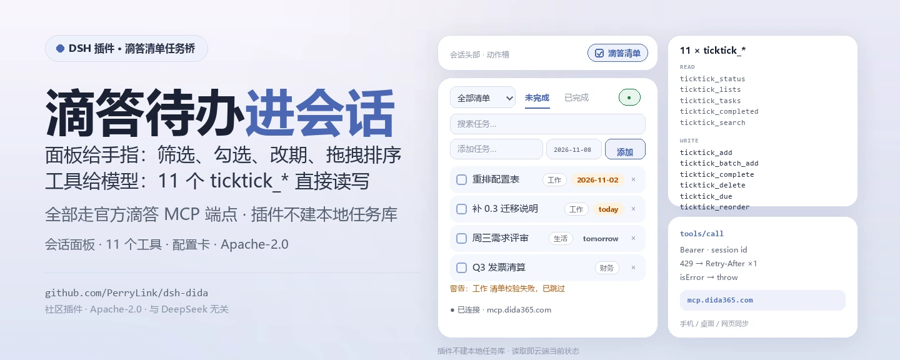
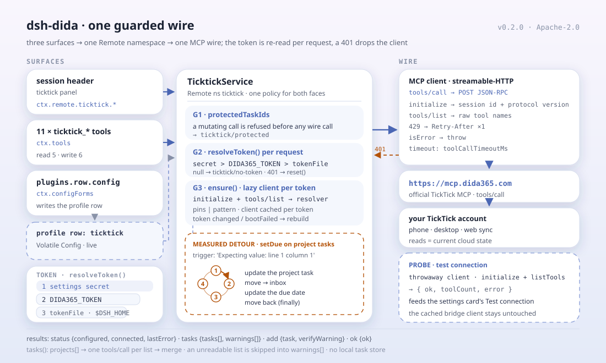

<div align="center">

<picture>
  <source media="(prefers-color-scheme: dark)" srcset="docs/assets/dsh-dida-hero-zh-dark.webp">
  
</picture>

# dsh-dida

**在会话头部直接管住滴答清单的待办——筛选、快加、完成、改期、拖拽排序，一句话交给 11 个 agent 工具。**

面向 DeepSeek Harness 的滴答清单（TickTick / Dida365）任务桥：会话头部任务面板、11 个 `ticktick_*` 工具、插件页配置卡与类型化 Remote 服务，全部走官方滴答 MCP 端点。

[安装](#三步上手) · [配置](#配置) · [FAQ](#faq) · [简体中文](README.md) · [English](README.en.md) · [Español](README.es.md) · [Português](README.pt.md) · [हिन्दी](README.hi.md)

[](LICENSE)
[](#兼容性)
[](https://www.npmjs.com/package/dsh-dida)
[](https://github.com/PerryLink/dsh-dida/actions/workflows/ci.yml)
[](#兼容性)

[](https://github.com/PerryLink/dsh-dida/stargazers)
[](https://www.npmjs.com/package/dsh-dida)
[](https://dshfind.com/plugins/PerryLink/dsh-dida?ref=badge)
[](https://dsh.market/)
[](https://gitee.com/perrylink/dsh-dida)

```sh
dsh plugin --profile <name> add dsh-dida
```

</div>

<sub>社区插件，与 DeepSeek 官方无关。唯一仓库：<https://github.com/PerryLink/dsh-dida>（Gitee 为镜像）。旧 npm 包 `@perrylink/dsh-ticktick` 已弃用，请安装 `dsh-dida`。</sub>

## 它是什么

`dsh-dida` 把滴答清单（TickTick / Dida365）接进 DeepSeek Harness：会话头部多出一个 `ticktick` 面板，可以按清单过滤、快速添加、勾选完成、确认删除、设置/清除截止日期、拖拽排序；没配令牌时还能在面板里一步粘贴保存。模型侧拿到 11 个 `ticktick_*` 工具，能查清单、加任务、改期、搜索、批量添加；插件页上还有一张配置卡。所有读写都走官方滴答 MCP 端点，落到你的滴答云端账号，手机/桌面/网页版同步可见——插件自己不建本地任务库。

<div align="center">

<picture>
  <source media="(prefers-color-scheme: dark)" srcset="docs/assets/dsh-dida-flow-v5-dark.svg">
  
</picture>

</div>

## 三步上手

1. **安装**（任选一个通道）：

   ```sh
   # git 通道（最新 main；等价于 git+https://github.com/PerryLink/dsh-dida.git）
   dsh plugin --profile web add github:PerryLink/dsh-dida
   # npm 通道（已发布版本，发布产物含 lib/，无需构建许可）
   dsh plugin --profile web add dsh-dida
   # git 源码钉住 commit（pnpm 首次会请你放行 prepare 构建）
   dsh plugin --profile web add "github:PerryLink/dsh-dida#<sha>"
   # tarball 通道：本仓库 pnpm pack 后
   dsh plugin --profile web add ./dsh-dida-<version>.tgz
   # 本地开发
   dsh plugin --profile web add link:/path/to/dsh-dida
   ```

   重启 `dsh web`（bundle 插件重启生效）。`ticktick` 按钮出现在会话头部；配置页从插件页 TickTick 行的 **Configure** 控件打开。

2. **最小配置**（默认值即可用；令牌三选一）：

   ```yaml
   - insert:
       - id: ticktick
         name: dsh-dida
         config:
           mcpUrl: https://mcp.dida365.com
   ```

   令牌优先级从高到低：配置卡的 secret 字段、`DIDA365_TOKEN` 环境变量、令牌文件（默认 `$DSH_HOME/.ticktick-token`，一行）。写文件即生效，无需任何配置变更。

3. **验证已生效**：

   ```sh
   dsh --profile web --dump-config | grep -A2 'id: ticktick'
   ```

   ```
   > ticktick_lists
   Inbox (inbox)
   Work (hex1)
   ```

   在会话里调用 `ticktick_lists`（或直接打开头部面板）能看到清单，就说明令牌与端点都通了。

**卸载**：`dsh plugin --profile web remove dsh-dida`。重启 `dsh web`。工具、面板、配置页、系统提示等全部运行态注册随插件卸载一并撤销。唯一静态残留是用户设置文档里的令牌——卸载前用 TickTick 配置页的**清除凭据**按钮抹掉（或删除令牌文件 / `DIDA365_TOKEN` 变量）即可彻底断开。想保留安装但暂时停用，改禁用该行：

```yaml
- id: ticktick
  disabled: true
```

<details>
<summary>从 DSH Desktop 市场安装</summary>

所有 PerryLink 插件均可在 DSH Desktop 内置市场中浏览：**市场 → 来源 → 添加来源 → 粘贴** `https://perrylink-dsh-catalog.perrylink.workers.dev/catalog-source.json` **→ 选中**。安装仍需通过市场的 npm 身份校验与你的确认。

</details>

## 核心能力

`dsh-dida` 把滴答清单变成会话里的一等公民：面板给手指，工具给模型，配置卡给令牌——任务数据始终在滴答云端。

- **会话头部面板** —— 按清单筛选（全部 + 各清单）、未完成/已完成视图切换、全文搜索、带可选日期的快速添加、勾选完成、确认删除、设置/清除截止日期（过期/今天/明天高亮 chip）、单清单未完成视图内拖拽排序。常驻连接状态圆点；未配置令牌时面板内直接一步粘贴保存。
- **11 个 agent 工具** —— 覆盖状态、清单、任务、增删改、截止日期、排序、已完成、搜索与批量添加；Code Mode 免费获得 `await tools.ticktick_*(args)`。
- **插件页配置卡** —— 插件页 → TickTick 行 → **Configure**：API 令牌（secret）、令牌文件、MCP 端点（国内/国际预设）、受保护任务 id；这四项均即时生效，无需重启。另有**测试连接**与**清除凭据**按钮。
- **令牌热重读** —— Bearer 令牌每次请求重读（配置卡 secret > `DIDA365_TOKEN` > 令牌文件，默认 `$DSH_HOME/.ticktick-token`）；401 会重置客户端，轮换令牌无需重启。
- **实测绕行** —— 滴答 MCP 对真实项目内任务调用 `update_task` 会服务端报错（`Expecting value: line 1 column 1`）；桥自动走「移到收件箱 → 更新 → 移回」绕行。服务端校验失败的清单（历史 `repeatFrom: ''` 数据）跳过并以逐清单警告透传，绝不静默丢弃。
- **受保护任务** —— 变更操作在任何网络调用前拒绝受保护 id 列表中的任务。
- **多端同步** —— 所有写入落在滴答云端账号，手机/电脑/网页版都能看到；每次读取都是当前状态。

### Agent 工具

| 工具 | 用途 |
|---|---|
| `ticktick_status` | 连接状态：令牌已配置、客户端已连接、端点、最近错误 |
| `ticktick_lists` | 全部清单（含虚拟收件箱） |
| `ticktick_tasks` | 未完成任务：单个清单或全部聚合，附带逐清单警告 |
| `ticktick_add` | 创建任务（清单、可选 ISO 截止日期） |
| `ticktick_complete` | 完成任务（任务 id + 清单 id） |
| `ticktick_delete` | 删除任务（任务 id + 清单 id） |
| `ticktick_due` | 设置/清除截止日期（省略日期 = 清除） |
| `ticktick_reorder` | 赋新整数 sortOrder（清单按 sortOrder 降序排列） |
| `ticktick_completed` | 时间窗内已完成任务（默认近 30 天），可选单清单 |
| `ticktick_search` | 任务全文搜索（官方 search 工具） |
| `ticktick_batch_add` | 一次调用批量创建任务 |

### 架构

```
浏览器面板 ── ctx.remote.ticktick.* ──▶ TicktickService（Typert Remote）
配置页 ─────── ctx.configForms ──────▶ profile 条目 "ticktick"（Volatile Config）
agent 工具 ── ctx.tools（ticktick_*）──▶ 同一服务
                    │
                    ▼
        迷你 streamable-HTTP MCP 客户端
        （session id、协议版本、Retry-After）
                    │
                    ▼
        https://mcp.dida365.com（官方滴答 MCP）
```

### 示例

以下为插件真实入口；安装后调用一个即可。

#### 详细示例

**命令**

~~~sh
ticktick_lists
~~~

**输入**

~~~json
{}
~~~

**输出**

~~~text
Inbox (inbox)
Work (hex1)
~~~

*Observed from `plugins/dsh-dida/src/tools.ts:107-109 (renderer); fixture/assertion at plugins/dsh-dida/tests/service.spec.ts:40-46,103-108`*

#### 失败分支

**输入**

~~~text
{"id":"t-guarded","projectId":"hex1"} (protectedTaskIds: ["t-guarded"])
~~~

**输出**

~~~text
Error: task t-guarded is protected
~~~

*Observed from `plugins/dsh-dida/src/service.ts:344-349; plugins/dsh-dida/tests/service.spec.ts:158-163`*

#### 简短示例

- `ticktick_tasks`
- `ticktick_add`

## 配置

所有可调项都是 Schemastery `Config` 字段（可从 cordis.yml 覆盖）。按 id 覆盖会替换整行——请重述所有需要的键。`cordis.patch.yml` 逐键内联注释。

拿到令牌的步骤：

1. 在滴答网页版获取 API 令牌（`dp_` 开头）：头像 → 设置 → 账户与安全 → API 令牌。
2. 三种令牌来源任选其一（优先级从高到低）：TickTick 配置页的 secret 字段、`DIDA365_TOKEN` 环境变量、令牌文件（默认 `$DSH_HOME/.ticktick-token`，一行）。
3. 用配置卡上的**测试连接**按钮验证令牌，**清除凭据**按钮一键抹除。

最常用键：

| 键 | 默认值 | 含义 |
|---|---|---|
| `token` | `''` | 配置卡 secret 字段里的 Bearer 令牌；优先级最高 |
| `tokenFile` | `''` | 存放令牌的文本文件路径；留空 = `$DSH_HOME/.ticktick-token` |
| `mcpUrl` | `https://mcp.dida365.com` | 滴答 MCP 端点（国际版端点未实测——见「已知限制」） |
| `toolCallTimeoutMs` | `30000` | 单次 tools/call 截止时间（毫秒），范围 1000–300000 |
| `protectedTaskIds` | `[]` | 所有变更操作在任何网络调用前拒绝的任务 id |
| `tools.*` | 各自 `''` | 原始 MCP 工具名钉住；`''` = 按模式发现 |

<details>
<summary>完整配置表（16 个键）</summary>

| 键 | 默认值 | 含义 |
|---|---|---|
| `token` | `''` | 配置卡 secret 字段里的 Bearer 令牌；优先级最高 |
| `tokenFile` | `''` | 存放令牌的文本文件路径；留空 = `$DSH_HOME/.ticktick-token` |
| `mcpUrl` | `https://mcp.dida365.com` | 滴答 MCP 端点（国际版端点未实测——见「已知限制」） |
| `toolCallTimeoutMs` | `30000` | 单次 tools/call 截止时间（毫秒），范围 1000–300000 |
| `protectedTaskIds` | `[]` | 所有变更操作在任何网络调用前拒绝的任务 id |
| `tools.projects` | `''` | project 列表工具的原始名钉住；`''` = 按模式发现 |
| `tools.tasks` | `''` | 未完成任务工具的原始名钉住；`''` = 按模式发现 |
| `tools.create` | `''` | 创建任务工具的原始名钉住；`''` = 按模式发现 |
| `tools.complete` | `''` | 完成任务工具的原始名钉住；`''` = 按模式发现 |
| `tools.remove` | `''` | 删除任务工具的原始名钉住；`''` = 按模式发现 |
| `tools.update` | `''` | 更新任务工具的原始名钉住；`''` = 按模式发现 |
| `tools.move` | `''` | 移动任务工具的原始名钉住；`''` = 按模式发现 |
| `tools.completed` | `''` | 已完成查询工具的原始名钉住；`''` = 按模式发现 |
| `tools.search` | `''` | 搜索工具的原始名钉住；`''` = 按模式发现 |
| `tools.getTask` | `''` | 按 id 取任务工具的原始名钉住；`''` = 按模式发现 |
| `tools.batchAdd` | `''` | 批量添加工具的原始名钉住；`''` = 按模式发现 |

</details>

profile patch 覆盖示例：

```yaml
- insert:
    - id: ticktick
      name: dsh-dida
      config:
        mcpUrl: https://mcp.dida365.com
        toolCallTimeoutMs: 30000
        protectedTaskIds: [t-guarded]
```

## FAQ

<details>
<summary>令牌由谁保存？会发到哪里？</summary>

令牌有三个来源：配置卡 secret 字段（存进 Host 的设置文档）、`DIDA365_TOKEN` 环境变量、令牌文件（默认 `$DSH_HOME/.ticktick-token`）。插件在每次请求时重读，只把 Bearer 头发给 `mcp.dida365.com`；配置卡上的令牌字段带 `role('secret')`，Host 会在表单回传里打码，配置页也只做按路径写入、不重建整段表单。`/api` 面是 harness 标准 Typert 网关，插件没有额外的 HTTP 服务。

</details>

<details>
<summary>滴答服务端的问题会让操作静默失败吗？</summary>

不会静默。`update_task` 对普通项目内任务会被滴答 MCP 拒绝（`Expecting value: line 1 column 1`），桥自动改走「移到收件箱 → 更新 → 移回」；服务端校验失败的清单（历史 `repeatFrom: ''` 数据）会跳过并在结果里带逐清单警告。受保护 id 的拒绝发生在任何网络调用之前，`ticktick_status` 会给出连接状态与最近错误。

</details>

<details>
<summary>会和其他插件抢命令、工具名或槽位吗？</summary>

不抢。11 个工具全部带 `ticktick_` 前缀；只注册一个 `ticktick` Remote 命名空间、一个会话头部 action（id `ticktick`）和一个 `plugins.row.config` 配置页条目；不注册 `webServer` 路由、不改全局对象。逐条见「与其他 DSH 插件的互操作性」。

</details>

<details>
<summary>性能开销多大？</summary>

没有常驻轮询，也没有本地任务索引：面板与工具每次按需发一次 MCP 调用，读到的都是云端当前状态；单次调用上限由 `toolCallTimeoutMs` 控制（默认 30 秒）。令牌每次请求重读，401 会重置客户端，轮换令牌无需重启。

</details>

<details>
<summary>没配令牌或端点连不上会怎样？</summary>

面板的状态圆点显示连接状态；未配置令牌时面板直接提供一步粘贴保存。模型侧调用 `ticktick_status` 可查看「令牌已配置 / 客户端已连接 / 端点 / 最近错误」，其余工具会把错误透传出来，不会伪造任务数据。

</details>

## 安全边界

- **令牌只存本地、只发滴答。** 令牌保存在 Host 的设置文档或你自己的令牌文件里，插件只把它作为 Bearer 头发给 `mcp.dida365.com`。不要把 `dsh web` 实例暴露到公网。
- **secret 字段由 Host 打码。** 令牌字段带 `role('secret')`，Host 会把它从每次表单回传中抹掉；配置页按路径写入、绝不整段重建表单，避免把已存令牌冲掉。
- **受保护 id 先于网络调用。** `protectedTaskIds` 中的任务在任何变更操作发出 wire 调用之前就被拒绝。
- **失败可见。** 401 会重置客户端；服务端校验失败的清单以逐清单警告透传，绝不静默丢弃；`ticktick_status` 暴露最近错误。
- **注册即 effect。** 服务、工具、系统提示段与配置表单都是 Cordis effect——卸载或热重载即可撤销。

## 权限与数据

- **权限**：`dshWorkshop` manifest 声明 `browser:local-storage`、`settings:read`、`settings:write`、`network:https://mcp.dida365.com`；`dsh.capabilities` 为 `network:egress` 与 `tools:register`。
- **数据**：任务与清单留在滴答云端账号；插件不建本地任务库，本地只保存令牌与配置（Host 设置文档或你自己的令牌文件）。
- **远端面**：面板通过 `ctx.remote.ticktick.*` 走 harness 标准 Typert 网关；插件不自建 HTTP 服务。

## 已知限制

- 国际版 TickTick 端点**未实测**：`mcpUrl` 默认国内端点，国际版 MCP URL 尚未探测。
- 已完成视图、搜索与批量添加走官方 MCP 的 `list_completed_tasks_by_date`、`search`、`batch_add_tasks` 工具；其线上契约来自已发布目录（dida365-sdk 存根），**对真实端点的复验待做**——先用真实令牌跑 `probes/probe-queries.mjs`，再宣称已核验。
- 实测到的 `update_task` 崩溃与清单校验失败是服务端行为；发布前用 `probes/` 对真实端点复验（导出 `DIDA365_TOKEN` 后运行）。
- 面板使用的 `/api` 面是 harness 标准 Typert 网关；令牌仅存本地（设置文档或令牌文件）且只发给滴答自己的服务器。不要把 `dsh web` 实例暴露到公网。

## 与其他 DSH 插件的互操作性

按本仓源码与 bundle 声明核对，`dsh-dida` 的接触面是刻意收窄的：

- **工具名全部带前缀。** 11 个工具都是 `ticktick_*`，不占用任何内置工具或其他插件的裸名。
- **只注册一个 Remote 命名空间。** 服务键是 `ticktick`；只有同样自称 `ticktick` 的插件才会撞键。
- **客户端只占两个具名槽位条目。** 会话头部 action `ticktick`（order 11）与插件行配置页 `@perrylink/dsh-ticktick#ticktick`；配置页只在对应行存在时出现，不注册其他 slot。
- **不注册 `webServer` 前缀**，不改原型、不改写 `process.env`、不替换全局 fetch dispatcher。
- **patch 只 insert 自己那一行。** `cordis.patch.yml` 不覆写内置行的 `config`，按 id 覆盖时需自行重述整行键。
- **自带最小 MCP 客户端。** `src/mcp.ts` 不采用 `@deepseek-ai/dsh-mcp-client` 的连接监管形态——后者会注册 `mcp__<server>__<tool>` 工具并替换掉这 11 个精选工具名；本插件保留自己的 transport 与可测绕行。

因此它不会与内置工具或其他插件抢占名字、路由或全局状态；唯一需要避让的是同名 `ticktick` 服务命名空间。

## 兼容性

| 维度 | 状态 |
|---|---|
| Harness | DeepSeek Harness **dsh-v0.2.1-alpha.1**（GitHub tag）。npm 依赖线钉在 `@deepseek-ai/dsh` **0.2.1-alpha.1**（peers `>=0.1.2-rc.1 <0.2.0 \|\| >=0.1.5-alpha.1 <0.2.0 \|\| >=0.1.6-0 <0.2.0 \|\| >=0.1.7-0 <0.2.0 \|\| >=0.2.0-0 <0.3.0 \|\| >=0.2.1-0 <0.3.0`）。已对照 dsh-v0.2.1-alpha.1 checkout 核验（完整门禁链 + profile 安装冒烟）。 |
| Node | `^22.19.0 \|\| >=24.0.0` |
| 平台 | 任何 DSH 可运行处；任务面板需要 Web 客户端（`dsh web`） |
| 模型 | 支持工具调用的文本模型即可；无需额外模型能力 |

## 生态与质量

- [Gitee 镜像](https://gitee.com/perrylink/dsh-dida)（同步镜像，以 GitHub 为准）
- [dshfind 插件页](https://dshfind.com/plugins/PerryLink/dsh-dida)（安装量与排名）
- [dsh-plugin-doctor 验证报告](https://github.com/PerryLink/dsh-plugin-doctor#verified-徽章)（仓库徽章指向的验证报告）
- [DSH Market](https://dsh.market/)（已上架）
- **1024 商店渠道**：先 `npm i -g dsh1024`，再 `dsh1024 plugin --profile web add dsh-dida`（计入 [deepseek1024.com](https://deepseek1024.com) 安装排行）
- [生态实测知识库](https://perrylink.github.io/dsh-plugin-guide/)：插件开发指南 · 选型实测数据 · 维护取舍判据

## 开发

```sh
pnpm install                                       # node ^22.19 || >=24
pnpm run typecheck && pnpm run typecheck:ci        # 两把尺子：checkout 面（带守卫，无 checkout 时不可验证）+ 已发布线面
pnpm test                                          # vitest
pnpm run build                                     # scripts/prepare.mjs：tsc 声明 + tsdown 打包
pnpm run verify:self-contained                     # 依赖 spec 均来自 registry
pnpm run verify:artifacts                          # 发布文件齐全 + 产物可导入
pnpm run check:readmes                             # 五语 README 一致性
pnpm pack                                          # 发布 tarball
```

构建产物在 `lib/`：`lib/index.js`、`lib/typert.host.js`、`lib/client.js` 与 `lib/types/`。配图由 [`scripts/gen-readme-assets.py`](scripts/gen-readme-assets.py) 程序化生成（Pillow 画 hero，手写 SVG 画结构图），可重复执行：`python scripts/gen-readme-assets.py` 写出 `docs/assets/dsh-dida-hero-{zh,en}-{light,dark}.webp` 与 `docs/assets/dsh-dida-flow-v5-{light,dark}.svg`（hero 按语言本地化，结构图只有命令 token，五语共用）。

### 对真实端点复验

```sh
# PowerShell
$env:DIDA365_TOKEN='dp_...'
node probes/probe-bootstrap.mjs      # 握手 + 工具目录
node probes/probe-crud.mjs           # 创建/完成/删除往返
node probes/probe-due.mjs            # 截止日期（带 PROJECT_ID 可测绕行）
node probes/probe-reorder.mjs        # sortOrder 语义
node probes/probe-queries.mjs        # P2 查询工具契约探测
```

Topics：`dsh`, `dsh-plugin`, `deepseek-harness`, `deepseek`, `cordis`, `ticktick`, `dida365`, `todo`, `task`, `mcp`, `widget`

## 家族与致谢

本项目是 [PerryLink](https://github.com/PerryLink) 维护的 DeepSeek Harness 插件家族成员（全部 Apache-2.0）。如果这个插件帮到了你，**给个 star**——它不解锁任何功能，但会让下一个人更容易找到它。

- [@PerryLink](https://github.com/PerryLink) —— 创建者与维护者：会话头部任务面板、11 个 `ticktick_*` 工具、插件页配置卡与类型化 Remote 服务，以及五语文档。

<details>
<summary>展开全部插件</summary>

| 插件 | 状态 |
|---|---|
| **[dsh-aqua-input-check](https://github.com/PerryLink/dsh-aqua-input-check)** |  |
| **[dsh-archive-check](https://github.com/PerryLink/dsh-archive-check)** |  |
| **[dsh-auto-review](https://github.com/PerryLink/dsh-auto-review)** |  |
| **[dsh-autotier](https://github.com/PerryLink/dsh-autotier)** | 🧊 已冻结 — 见仓库 README |
| **[dsh-bid-ca-precheck](https://github.com/PerryLink/dsh-bid-ca-precheck)** |  |
| **[dsh-bid-qual-check](https://github.com/PerryLink/dsh-bid-qual-check)** |  |
| **[dsh-cert-mcp](https://github.com/PerryLink/dsh-cert-mcp)** | 🧊 已冻结 — 见仓库 README |
| **[dsh-checkpoint-rewind](https://github.com/PerryLink/dsh-checkpoint-rewind)** |  |
| **[dsh-click](https://github.com/PerryLink/dsh-click)** |  |
| **[dsh-composer-history](https://github.com/PerryLink/dsh-composer-history)** |  |
| **[dsh-contract-stance](https://github.com/PerryLink/dsh-contract-stance)** |  |
| **[dsh-customs-doc-check](https://github.com/PerryLink/dsh-customs-doc-check)** |  |
| **[dsh-data-quality](https://github.com/PerryLink/dsh-data-quality)** | 🧊 已冻结 — 见仓库 README |
| **[dsh-demurrage-ledger](https://github.com/PerryLink/dsh-demurrage-ledger)** |  |
| **[dsh-doublecheck](https://github.com/PerryLink/dsh-doublecheck)** |  |
| **[dsh-drill-script-check](https://github.com/PerryLink/dsh-drill-script-check)** |  |
| **[dsh-eia-guide-check](https://github.com/PerryLink/dsh-eia-guide-check)** |  |
| **[dsh-emergency-plan](https://github.com/PerryLink/dsh-emergency-plan)** |  |
| **[dsh-essay-rubric-check](https://github.com/PerryLink/dsh-essay-rubric-check)** |  |
| **[dsh-evidence-check](https://github.com/PerryLink/dsh-evidence-check)** |  |
| **[dsh-export-ctl-check](https://github.com/PerryLink/dsh-export-ctl-check)** |  |
| **[dsh-fast](https://github.com/PerryLink/dsh-fast)** |  |
| **[dsh-fmea-table-check](https://github.com/PerryLink/dsh-fmea-table-check)** |  |
| **[dsh-forecast-penalty](https://github.com/PerryLink/dsh-forecast-penalty)** |  |
| **[dsh-fund-research](https://github.com/PerryLink/dsh-fund-research)** |  |
| **[dsh-github](https://github.com/PerryLink/dsh-github)** |  |
| **[dsh-gongwen-flow-check](https://github.com/PerryLink/dsh-gongwen-flow-check)** |  |
| **[dsh-gongwen-word-check](https://github.com/PerryLink/dsh-gongwen-word-check)** |  |
| **[dsh-guard-plan-qc](https://github.com/PerryLink/dsh-guard-plan-qc)** |  |
| **[dsh-hazchem-check](https://github.com/PerryLink/dsh-hazchem-check)** |  |
| **[dsh-hazplan-check](https://github.com/PerryLink/dsh-hazplan-check)** |  |
| **[dsh-hidden-risk-map](https://github.com/PerryLink/dsh-hidden-risk-map)** |  |
| **[dsh-hs-classify](https://github.com/PerryLink/dsh-hs-classify)** |  |
| **[dsh-icd-rule-check](https://github.com/PerryLink/dsh-icd-rule-check)** |  |
| **[dsh-industry-research](https://github.com/PerryLink/dsh-industry-research)** |  |
| **[dsh-lawcite-adapter](https://github.com/PerryLink/dsh-lawcite-adapter)** |  |
| **[dsh-laya](https://github.com/PerryLink/dsh-laya)** |  |
| **[dsh-lc-doc-check](https://github.com/PerryLink/dsh-lc-doc-check)** |  |
| **[dsh-learning-gap-check](https://github.com/PerryLink/dsh-learning-gap-check)** |  |
| **[dsh-library](https://github.com/PerryLink/dsh-library)** |  |
| **[dsh-local-ai](https://github.com/PerryLink/dsh-local-ai)** |  |
| **[dsh-lsp-actions](https://github.com/PerryLink/dsh-lsp-actions)** |  |
| **[dsh-mask](https://github.com/PerryLink/dsh-mask)** |  |
| **[dsh-mcp-panel](https://github.com/PerryLink/dsh-mcp-panel)** |  |
| **[dsh-medrec-qc](https://github.com/PerryLink/dsh-medrec-qc)** |  |
| **[dsh-memento](https://github.com/PerryLink/dsh-memento)** | 🧊 已冻结 — 见仓库 README |
| **[dsh-nsfc-form-check](https://github.com/PerryLink/dsh-nsfc-form-check)** |  |
| **[dsh-nurse-record-check](https://github.com/PerryLink/dsh-nurse-record-check)** |  |
| **[dsh-observe](https://github.com/PerryLink/dsh-observe)** |  |
| **[dsh-origin-rvc-check](https://github.com/PerryLink/dsh-origin-rvc-check)** |  |
| **[dsh-ota-review-check](https://github.com/PerryLink/dsh-ota-review-check)** |  |
| **[dsh-output-styles](https://github.com/PerryLink/dsh-output-styles)** |  |
| **[dsh-paper-doc-adapter](https://github.com/PerryLink/dsh-paper-doc-adapter)** |  |
| **[dsh-permission-rules](https://github.com/PerryLink/dsh-permission-rules)** |  |
| **[dsh-permit-report-check](https://github.com/PerryLink/dsh-permit-report-check)** |  |
| **[dsh-pipeline-check](https://github.com/PerryLink/dsh-pipeline-check)** |  |
| **[dsh-pleading-draft](https://github.com/PerryLink/dsh-pleading-draft)** |  |
| **[dsh-plugin-doctor](https://github.com/PerryLink/dsh-plugin-doctor)** | 🚫 已退役（仓库已归档） |
| **[dsh-plugin-guide](https://github.com/PerryLink/dsh-plugin-guide)** |  |
| **[dsh-plugin-kit](https://github.com/PerryLink/dsh-plugin-kit)** | 🚫 已退役（仓库已归档） |
| **[dsh-plugin-upgrade](https://github.com/PerryLink/dsh-plugin-upgrade)** | 🚫 已退役（仓库已归档） |
| **[dsh-policy-brief-draft](https://github.com/PerryLink/dsh-policy-brief-draft)** |  |
| **[dsh-power-loss-split](https://github.com/PerryLink/dsh-power-loss-split)** |  |
| **[dsh-power-ticket-check](https://github.com/PerryLink/dsh-power-ticket-check)** |  |
| **[dsh-ppap-check](https://github.com/PerryLink/dsh-ppap-check)** |  |
| **[dsh-protest-deadline](https://github.com/PerryLink/dsh-protest-deadline)** |  |
| **[dsh-railway-window](https://github.com/PerryLink/dsh-railway-window)** |  |
| **[dsh-repair-order-qc](https://github.com/PerryLink/dsh-repair-order-qc)** |  |
| **[dsh-research-report](https://github.com/PerryLink/dsh-research-report)** |  |
| **[dsh-review-reply-check](https://github.com/PerryLink/dsh-review-reply-check)** |  |
| **[dsh-rulefile-check](https://github.com/PerryLink/dsh-rulefile-check)** |  |
| **[dsh-safety-brief-check](https://github.com/PerryLink/dsh-safety-brief-check)** |  |
| **[dsh-score](https://github.com/PerryLink/dsh-score)** | 🧊 已冻结 — 见仓库 README |
| **[dsh-session-sync](https://github.com/PerryLink/dsh-session-sync)** |  |
| **[dsh-site-log-check](https://github.com/PerryLink/dsh-site-log-check)** |  |
| **[dsh-skill-pack-security](https://github.com/PerryLink/dsh-skill-pack-security)** |  |
| **[dsh-soe-decision-check](https://github.com/PerryLink/dsh-soe-decision-check)** |  |
| **[dsh-soilwater-check](https://github.com/PerryLink/dsh-soilwater-check)** |  |
| **[dsh-sop-sync-check](https://github.com/PerryLink/dsh-sop-sync-check)** |  |
| **[dsh-spc-gbt-adapter](https://github.com/PerryLink/dsh-spc-gbt-adapter)** |  |
| **[dsh-talk](https://github.com/PerryLink/dsh-talk)** |  |
| **[dsh-tender-extract](https://github.com/PerryLink/dsh-tender-extract)** |  |
| **[dsh-tender-matrix](https://github.com/PerryLink/dsh-tender-matrix)** |  |
| **[dsh-test-drive](https://github.com/PerryLink/dsh-test-drive)** |  |
| **[dsh-dida](https://github.com/PerryLink/dsh-dida)** |  |
| **[dsh-translate](https://github.com/PerryLink/dsh-translate)** |  |
| **[dsh-warranty-calc](https://github.com/PerryLink/dsh-warranty-calc)** |  |
| **[dsh-budget](https://github.com/PerryLink/dsh-budget)** | 🧊 已冻结 — 见仓库 README |
| **[dsh-claude-move](https://github.com/PerryLink/dsh-claude-move)** | 🧊 已冻结 — 见仓库 README |
| **[dsh-defend](https://github.com/PerryLink/dsh-defend)** | 🧊 已冻结 — 见仓库 README |
| **[dsh-draw](https://github.com/PerryLink/dsh-draw)** | 🧊 已冻结 — 见仓库 README |
| **[dsh-reach](https://github.com/PerryLink/dsh-reach)** | 🧊 已冻结 — 见仓库 README |
| **[dsh-background-agents](https://github.com/PerryLink/dsh-background-agents)** | 🚫 已退役（仓库已归档） |
| **[dsh-session-pin](https://github.com/PerryLink/dsh-session-pin)** | 🚫 已退役（仓库已归档） |
| **[dsh-team-rooms](https://github.com/PerryLink/dsh-team-rooms)** | 🚫 已退役（仓库已归档） |

</details>

## License

[LICENSE](LICENSE)（Apache License 2.0）© 2026 dsh-dida contributors

<p align="center"><sub>Apache-2.0 · 社区插件，与 DeepSeek 无关。</sub></p>
