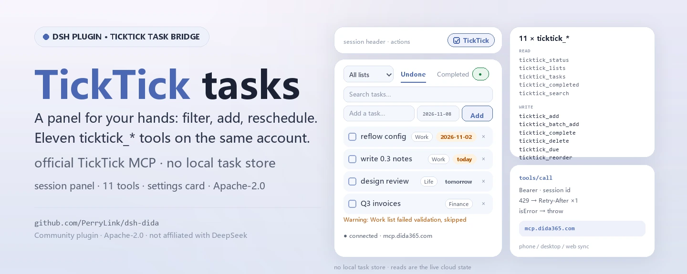
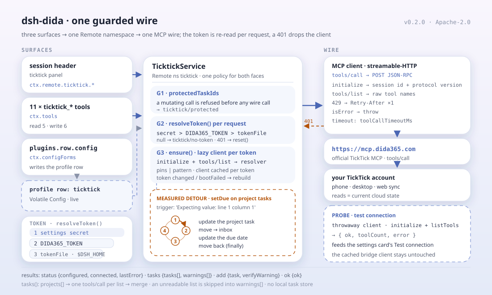

<div align="center">

<picture>
  <source media="(prefers-color-scheme: dark)" srcset="docs/assets/dsh-dida-hero-en-dark.webp">
  
</picture>

# dsh-dida

**Gerencie suas tarefas do TickTick / Dida365 direto na cabeceira da sessão: filtre, adicione, conclua, reprograme, reordene arrastando e deixe o resto com onze ferramentas do agente.**

Uma ponte de tarefas TickTick / Dida365 para o DeepSeek Harness: painel de tarefas na cabeceira da sessão, onze ferramentas `ticktick_*`, um cartão de configuração na página Plugins e um serviço Remote tipado — tudo sobre o endpoint MCP oficial do TickTick.

[Instalação](#instalação-em-três-passos) · [Configuração](#configuração) · [FAQ](#faq) · [简体中文](README.md) · [English](README.en.md) · [Español](README.es.md) · [Português](README.pt.md) · [हिन्दी](README.hi.md)

[](LICENSE)
[](#compatibilidade)
[](https://www.npmjs.com/package/dsh-dida)
[](https://github.com/PerryLink/dsh-dida/actions/workflows/ci.yml)
[](#compatibilidade)

[](https://github.com/PerryLink/dsh-dida/stargazers)
[](https://www.npmjs.com/package/dsh-dida)
[](https://dshfind.com/plugins/PerryLink/dsh-dida?ref=badge)
[](https://dsh.market/)
[](https://gitee.com/perrylink/dsh-dida)

```sh
dsh plugin --profile <name> add dsh-dida
```

</div>

<sub>Plugin da comunidade, sem afiliação com a DeepSeek. Repositório canônico: <https://github.com/PerryLink/dsh-dida> (o Gitee é um espelho). O pacote npm antigo `@perrylink/dsh-ticktick` está obsoleto; instale `dsh-dida`.</sub>

## O que é

O `dsh-dida` traz o TickTick / Dida365 para o DeepSeek Harness: a cabeceira da sessão ganha um painel `ticktick` para filtrar por lista, adicionar rápido, concluir, excluir com confirmação, definir ou limpar datas de vencimento e reordenar arrastando; sem token configurado, o painel oferece a configuração em um passo. O modelo recebe onze ferramentas `ticktick_*` para listas, criação/edição/exclusão, datas, ordenação, concluídas, busca e inclusão em lote, além de um cartão de configuração na página Plugins. Toda leitura e escrita passa pelo endpoint MCP oficial do TickTick e cai na sua conta TickTick na nuvem, então celular, desktop e web a veem — o plugin não guarda nenhum banco de tarefas local.

<div align="center">

<picture>
  <source media="(prefers-color-scheme: dark)" srcset="docs/assets/dsh-dida-flow-v5-dark.svg">
  
</picture>

</div>

## Instalação em três passos

1. **Instale** (escolha um canal):

   ```sh
   # canal git (último main; equivalente a git+https://github.com/PerryLink/dsh-dida.git)
   dsh plugin --profile web add github:PerryLink/dsh-dida
   # canal npm (versões publicadas; lib/ vai no tarball, sem permissão de build)
   dsh plugin --profile web add dsh-dida
   # código git fixado em um commit (o pnpm pede para permitir o build prepare uma vez)
   dsh plugin --profile web add "github:PerryLink/dsh-dida#<sha>"
   # canal tarball: pnpm pack neste repo e depois
   dsh plugin --profile web add ./dsh-dida-<version>.tgz
   # desenvolvimento local
   dsh plugin --profile web add link:/path/to/dsh-dida
   ```

   Reinicie o `dsh web` (plugins bundle ativam no reinício). A ação `ticktick` aparece na cabeceira da sessão; a página de configuração abre pelo controle **Configure** na linha TickTick da página Plugins.

2. **Configuração mínima** (os padrões funcionam; escolha uma fonte de token):

   ```yaml
   - insert:
       - id: ticktick
         name: dsh-dida
         config:
           mcpUrl: https://mcp.dida365.com
   ```

   Prioridade do token, da maior para a menor: o campo secreto do cartão de configuração, a variável de ambiente `DIDA365_TOKEN` e um arquivo de token (padrão `$DSH_HOME/.ticktick-token`, uma linha). Escrever o arquivo ativa a ponte sem nenhuma mudança de configuração.

3. **Verifique que monta**:

   ```sh
   dsh --profile web --dump-config | grep -A2 'id: ticktick'
   ```

   ```
   > ticktick_lists
   Inbox (inbox)
   Work (hex1)
   ```

   Se `ticktick_lists` (ou o painel da cabeceira) mostrar suas listas, o token e o endpoint estão ativos.

**Desinstalar**: `dsh plugin --profile web remove dsh-dida`. Reinicie o `dsh web`. Todos os registros em execução (ferramentas, painel, página de configuração, seção do prompt) saem com o plugin. O único resíduo estático é o token no documento de configurações do usuário: limpe-o antes com o botão **Clear credentials** da página de configuração do TickTick (ou remova o arquivo de token / a variável `DIDA365_TOKEN`) para desligar de vez. Para manter o pacote instalado mas inativo, desative a linha:

```yaml
- id: ticktick
  disabled: true
```

<details>
<summary>Instalar a partir do mercado do DSH Desktop</summary>

Todo plugin PerryLink está listado no mercado integrado do DSH Desktop: **Market → Sources → Add source → colar** `https://perrylink-dsh-catalog.perrylink.workers.dev/catalog-source.json` **→ selecionar**. A instalação ainda exige a verificação de identidade npm do mercado e a sua confirmação.

</details>

## Capacidades principais

O `dsh-dida` transforma o TickTick em cidadão de primeira classe da sessão: o painel é para os dedos, as ferramentas para o modelo e o cartão para o token — as tarefas ficam na nuvem do TickTick.

- **Painel na cabeceira da sessão** — filtrar por lista (Todas + cada lista), alternar visões pendentes/concluídas, busca de texto completo, adicionar tarefas com data de vencimento opcional, concluir, excluir com confirmação, definir/limpar datas de vencimento com chips vencida/hoje/amanhã e reordenar arrastando em visões pendentes de uma única lista. Um ponto de status mostra a conexão; sem token configurado, o painel oferece a configuração do token em um passo.
- **Onze ferramentas do agente** — status, listas, tarefas, criação/conclusão/exclusão, datas de vencimento, reordenação, concluídas, busca e inclusão em lote; o Code Mode ganha `await tools.ticktick_*(args)` de graça.
- **Cartão de configuração** — página Plugins → a linha TickTick → **Configure**: token de API (secreto), arquivo de token, endpoint MCP (presets CN/Internacional), ids de tarefas protegidos; os quatro se aplicam ao vivo, sem reinício. Além disso, botões **Test connection** e **Clear credentials**.
- **Releitura do token ao vivo** — o token Bearer é relido a cada requisição (segredo do cartão > `DIDA365_TOKEN` > arquivo de token, padrão `$DSH_HOME/.ticktick-token`); um 401 reinicia o cliente para que um token trocado ative sem reiniciar.
- **Contornos medidos** — o MCP do TickTick rejeita `update_task` para tarefas dentro de projetos normais (`Expecting value: line 1 column 1`); a ponte tenta de novo via mover-para-caixa → atualizar → devolver. As listas que falham na validação do servidor (dados históricos `repeatFrom: ''`) são puladas e reportadas como avisos por lista, nunca descartadas em silêncio.
- **Ids protegidos** — operações de mutação recusam tarefas da lista protegida antes de qualquer chamada de rede.
- **Sincronização multidispositivo** — toda escrita cai na conta TickTick na nuvem, então celular/desktop/web a veem; toda leitura traz o estado atual.

### Ferramentas do agente

| Ferramenta | Propósito |
|---|---|
| `ticktick_status` | estado da conexão: token configurado, cliente conectado, endpoint, último erro |
| `ticktick_lists` | todas as listas (projetos), a Caixa de entrada virtual incluída |
| `ticktick_tasks` | tarefas pendentes: uma lista ou todas agregadas, com avisos por lista |
| `ticktick_add` | criar uma tarefa (lista, data ISO opcional) |
| `ticktick_complete` | concluir uma tarefa (id da tarefa + id da lista) |
| `ticktick_delete` | excluir uma tarefa (id da tarefa + id da lista) |
| `ticktick_due` | definir/limpar uma data de vencimento (omitir a data para limpar) |
| `ticktick_reorder` | atribuir um novo sortOrder inteiro (as listas ordenam por sortOrder decrescente) |
| `ticktick_completed` | tarefas concluídas em uma janela (30 dias por padrão), opcionalmente uma lista |
| `ticktick_search` | busca de texto completo nas tarefas (a ferramenta oficial de busca) |
| `ticktick_batch_add` | criar várias tarefas em uma chamada |

### Arquitetura

```
painel do navegador ── ctx.remote.ticktick.* ──▶ TicktickService (Typert Remote)
página de configuração ── ctx.configForms ──▶ entrada de perfil "ticktick" (Config Volatile)
ferramentas ──────── ctx.tools (ticktick_*) ─▶ o mesmo serviço
                     │
                     ▼
         cliente MCP HTTP streamable mínimo
         (id de sessão, versão de protocolo, Retry-After)
                     │
                     ▼
         https://mcp.dida365.com  (MCP oficial do TickTick)
```

### Exemplos

Estes são os pontos de entrada reais do plugin; instale uma vez e chame um.

#### Exemplo detalhado

**Comando**

~~~sh
ticktick_lists
~~~

**Entrada**

~~~json
{}
~~~

**Saída**

~~~text
Inbox (inbox)
Work (hex1)
~~~

*Observed from `plugins/dsh-dida/src/tools.ts:107-109 (renderer); fixture/assertion at plugins/dsh-dida/tests/service.spec.ts:40-46,103-108`*

#### Ramo de falha

**Entrada**

~~~text
{"id":"t-guarded","projectId":"hex1"} (protectedTaskIds: ["t-guarded"])
~~~

**Saída**

~~~text
Error: task t-guarded is protected
~~~

*Observed from `plugins/dsh-dida/src/service.ts:344-349; plugins/dsh-dida/tests/service.spec.ts:158-163`*

#### Exemplos breves

- `ticktick_tasks`
- `ticktick_add`

## Configuração

Todas as opções são campos Schemastery `Config` (alteráveis via cordis.yml). Uma sobrescrita por id substitui a linha inteira — repita todas as chaves de que precisar. O `cordis.patch.yml` documenta cada chave inline.

Como obter um token:

1. No app web do Dida365/TickTick, abra Perfil → Configurações → Conta e segurança → Token de API (um token com prefixo `dp_`).
2. Escolha uma das três fontes de token (ordem de prioridade): o campo secreto da página de configuração do TickTick, a variável de ambiente `DIDA365_TOKEN` ou um arquivo de token (padrão `$DSH_HOME/.ticktick-token`, uma linha).
3. Use o botão **Test connection** do cartão para verificar o token e **Clear credentials** para apagá-lo.

Chaves mais usadas:

| Chave | Padrão | Significado |
|---|---|---|
| `token` | `''` | Token Bearer do campo secreto do cartão de configuração; prioridade máxima |
| `tokenFile` | `''` | Arquivo de texto com o token; vazio = `$DSH_HOME/.ticktick-token` |
| `mcpUrl` | `https://mcp.dida365.com` | Endpoint MCP do TickTick (o internacional não está verificado — ver Limitações conhecidas) |
| `toolCallTimeoutMs` | `30000` | Prazo por tools/call em ms, 1000–300000 |
| `protectedTaskIds` | `[]` | Ids que toda mutação recusa antes de qualquer chamada de rede |
| `tools.*` | `''` cada um | Nomes MCP fixados; `''` = descobrir por padrão |

<details>
<summary>Tabela completa de configuração (16 chaves)</summary>

| Chave | Padrão | Significado |
|---|---|---|
| `token` | `''` | Token Bearer do campo secreto do cartão de configuração; prioridade máxima |
| `tokenFile` | `''` | Arquivo de texto com o token; vazio = `$DSH_HOME/.ticktick-token` |
| `mcpUrl` | `https://mcp.dida365.com` | Endpoint MCP do TickTick (o internacional não está verificado — ver Limitações conhecidas) |
| `toolCallTimeoutMs` | `30000` | Prazo por tools/call em ms, 1000–300000 |
| `protectedTaskIds` | `[]` | Ids que toda mutação recusa antes de qualquer chamada de rede |
| `tools.projects` | `''` | Nome fixado da ferramenta de projetos; `''` = descobrir por padrão |
| `tools.tasks` | `''` | Nome fixado da ferramenta de tarefas pendentes; `''` = descobrir por padrão |
| `tools.create` | `''` | Nome fixado da ferramenta de criação; `''` = descobrir por padrão |
| `tools.complete` | `''` | Nome fixado da ferramenta de conclusão; `''` = descobrir por padrão |
| `tools.remove` | `''` | Nome fixado da ferramenta de exclusão; `''` = descobrir por padrão |
| `tools.update` | `''` | Nome fixado da ferramenta de atualização; `''` = descobrir por padrão |
| `tools.move` | `''` | Nome fixado da ferramenta de movimentação; `''` = descobrir por padrão |
| `tools.completed` | `''` | Nome fixado da ferramenta de concluídas; `''` = descobrir por padrão |
| `tools.search` | `''` | Nome fixado da ferramenta de busca; `''` = descobrir por padrão |
| `tools.getTask` | `''` | Nome fixado da ferramenta de tarefa por id; `''` = descobrir por padrão |
| `tools.batchAdd` | `''` | Nome fixado da ferramenta de inclusão em lote; `''` = descobrir por padrão |

</details>

Exemplo de sobrescrita no seu patch de perfil:

```yaml
- insert:
    - id: ticktick
      name: dsh-dida
      config:
        mcpUrl: https://mcp.dida365.com
        toolCallTimeoutMs: 30000
        protectedTaskIds: [t-guarded]
```

## FAQ

<details>
<summary>Quem guarda o token e para onde ele é enviado?</summary>

O token tem três fontes: o campo secreto do cartão de configuração (guardado no documento de configurações do host), a variável de ambiente `DIDA365_TOKEN` e um arquivo de token (padrão `$DSH_HOME/.ticktick-token`). O plugin o relê a cada requisição e só o envia como cabeçalho Bearer para `mcp.dida365.com`. O campo do token carrega `role('secret')`, então o host o redige em toda resposta de formulário, e a página de configuração grava por caminho em vez de reconstruir a seção inteira. A superfície `/api` é o gateway Typert padrão do harness; o plugin não sobe nenhum servidor HTTP próprio.

</details>

<details>
<summary>Problemas do servidor do TickTick falham em silêncio?</summary>

Nada é silencioso. O MCP do TickTick rejeita `update_task` para tarefas dentro de projetos normais (`Expecting value: line 1 column 1`), então a ponte tenta de novo via mover-para-caixa → atualizar → devolver. As listas que falham na validação do servidor (dados históricos `repeatFrom: ''`) são puladas e exibidas como avisos por lista. As recusas por id protegido acontecem antes de qualquer chamada de rede, e `ticktick_status` informa o estado da conexão e o último erro.

</details>

<details>
<summary>Ele briga com outros plugins por comandos, nomes de ferramenta ou slots?</summary>

Não. As onze ferramentas levam o prefixo `ticktick_`; ele registra um único namespace Remote `ticktick`, uma ação de cabeceira da sessão (id `ticktick`) e uma entrada `plugins.row.config`; não registra rotas `webServer` nem muta globais. O argumento ponto a ponto está em «Interoperabilidade com outros plugins DSH».

</details>

<details>
<summary>Qual é o tamanho do custo de desempenho?</summary>

Não há polling em segundo plano nem índice local de tarefas: o painel e as ferramentas fazem uma chamada MCP sob demanda e sempre leem o estado atual na nuvem; cada chamada é limitada por `toolCallTimeoutMs` (30 segundos por padrão). O token é relido a cada requisição e um 401 reinicia o cliente, então trocar o token não exige reiniciar.

</details>

<details>
<summary>O que acontece sem token ou com o endpoint inacessível?</summary>

O ponto de status do painel mostra a conexão, e sem token configurado o painel oferece a configuração em um passo. Do lado do modelo, `ticktick_status` informa «token configurado / cliente conectado / endpoint / último erro»; as demais ferramentas propagam o erro em vez de inventar dados de tarefas.

</details>

## Limites de segurança

- **O token fica local e só vai para o TickTick.** Ele vive no documento de configurações do host ou no seu próprio arquivo de token, e o plugin só o envia como cabeçalho Bearer para `mcp.dida365.com`. Não exponha uma instância `dsh web` à internet pública.
- **O campo secreto é redigido pelo host.** O campo do token carrega `role('secret')`, então o host o remove de toda resposta de formulário; a página de configuração grava por caminho e nunca reconstrói a seção, o que apagaria o token guardado.
- **Os ids protegidos vêm antes da rede.** Tarefas em `protectedTaskIds` são recusadas antes de qualquer mutação fazer chamada de rede.
- **As falhas continuam visíveis.** Um 401 reinicia o cliente; as listas que falham na validação do servidor aparecem como avisos por lista em vez de serem descartadas em silêncio; `ticktick_status` expõe o último erro.
- **Registros são efeitos.** O serviço, as ferramentas, a seção do prompt e o formulário de configurações são efeitos Cordis: descarregar ou recarregar a quente os remove.

## Permissões e dados

- **Permissões**: o manifest `dshWorkshop` declara `browser:local-storage`, `settings:read`, `settings:write` e `network:https://mcp.dida365.com`; `dsh.capabilities` lista `network:egress` e `tools:register`.
- **Dados**: tarefas e listas ficam na sua conta TickTick na nuvem; o plugin não guarda nenhum banco de tarefas local e só persiste o token e a configuração (documento de configurações do host ou seu arquivo de token).
- **Superfície remota**: o painel passa por `ctx.remote.ticktick.*` sobre o gateway Typert padrão do harness; o plugin não sobe nenhum servidor HTTP próprio.

## Limitações conhecidas

- O endpoint internacional do TickTick **não está verificado**: `mcpUrl` aponta por padrão para o endpoint CN e a URL MCP internacional não foi testada.
- A visão de concluídas, a busca e a inclusão em lote usam as ferramentas MCP `list_completed_tasks_by_date`, `search` e `batch_add_tasks`; seus contratos vêm do catálogo publicado (stubs do `dida365-sdk`) e a **reverificação contra o endpoint real está pendente**: rode `probes/probe-queries.mjs` com um token real antes de considerá-los verificados.
- O crash medido de `update_task` e as falhas de validação de listas são comportamentos do servidor; `probes/` os reverifica contra o endpoint real antes de um release (rode com `DIDA365_TOKEN` exportado).
- A superfície `/api` que o painel usa é o gateway Typert padrão do harness; o token é guardado localmente (documento de configurações ou arquivo de token) e enviado só aos servidores do TickTick. Não exponha uma instância `dsh web` à internet pública.

## Interoperabilidade com outros plugins DSH

Conferido contra o código e a declaração do bundle deste repositório, o `dsh-dida` mantém deliberadamente estreita sua superfície de contato:

- **Todo nome de ferramenta tem prefixo.** As onze ferramentas são `ticktick_*`; nenhum nome puro de uma ferramenta embutida ou de outro plugin é ocupado.
- **Um único namespace Remote.** A chave de serviço é `ticktick`; só um plugin que reivindicasse o mesmo namespace `ticktick` poderia colidir.
- **Dois slots de cliente nomeados.** A ação de cabeceira da sessão `ticktick` (order 11) e a página de configuração `@perrylink/dsh-ticktick#ticktick`; a página só aparece quando a linha existe e nenhum outro slot é registrado.
- **Sem prefixo `webServer`**, sem patch de protótipos, sem reescrever `process.env` e sem substituir o dispatcher global de fetch.
- **O patch só insere a própria linha.** O `cordis.patch.yml` nunca sobrescreve o `config` de uma linha embutida; uma sobrescrita por id precisa repetir a linha inteira.
- **Ele mantém seu próprio cliente MCP mínimo.** O `src/mcp.ts` não adota a forma de supervisor do `@deepseek-ai/dsh-mcp-client` — esse pacote registra ferramentas `mcp__<server>__<tool>` e substituiria os onze nomes selecionados; este plugin mantém o próprio transporte e os contornos medidos.

Por isso ele não disputa nomes, rotas ou estado global com ferramentas embutidas nem com outros plugins; o único namespace a evitar é outro serviço `ticktick`.

## Compatibilidade

| Superfície | Estado |
|---|---|
| Harness | DeepSeek Harness **dsh-v0.2.1-alpha.1** (tag do GitHub). Linha npm fixada em `@deepseek-ai/dsh` **0.2.1-alpha.1** (peers `>=0.1.2-rc.1 <0.2.0 \|\| >=0.1.5-alpha.1 <0.2.0 \|\| >=0.1.6-0 <0.2.0 \|\| >=0.1.7-0 <0.2.0 \|\| >=0.2.0-0 <0.3.0 \|\| >=0.2.1-0 <0.3.0`). Verificado contra o checkout dsh-v0.2.1-alpha.1 (cadeia completa de gates + smoke de instalação de perfil). |
| Node | `^22.19.0 \|\| >=24.0.0` |
| Plataformas | Onde o DSH rodar; o painel de tarefas precisa de um cliente web (`dsh web`) |
| Modelo | Qualquer modelo de texto com tool calling; nenhuma capacidade extra necessária |

## Ecossistema e qualidade

- [Espelho do Gitee](https://gitee.com/perrylink/dsh-dida) (espelho sincronizado; o GitHub é o canônico)
- [Página do plugin no dshfind](https://dshfind.com/plugins/PerryLink/dsh-dida) (instalações e ranking)
- [Relatório de verificação do dsh-plugin-doctor](https://github.com/PerryLink/dsh-plugin-doctor#verified-徽章) (o relatório para o qual a insígnia do repositório aponta)
- [DSH Market](https://dsh.market/) (listado)
- **Canal da loja 1024**: `npm i -g dsh1024` uma vez e depois `dsh1024 plugin --profile web add dsh-dida` (conta para o ranking de instalações do [deepseek1024.com](https://deepseek1024.com))
- [Base de conhecimento do ecossistema](https://perrylink.github.io/dsh-plugin-guide/) — dados medidos, não marketing: guia de desenvolvimento de plugins · dados de seleção · critérios de manutenção

## Desenvolvimento

```sh
pnpm install                                       # node ^22.19 || >=24
pnpm run typecheck && pnpm run typecheck:ci        # duas réguas: face do checkout (com guarda; não verificável sem o checkout) + face da linha publicada
pnpm test                                          # vitest
pnpm run build                                     # scripts/prepare.mjs: declarações tsc + bundles tsdown
pnpm run verify:self-contained                     # as specs de dependências resolvem do registry
pnpm run verify:artifacts                          # arquivos enviados presentes + artefatos importáveis
pnpm run check:readmes                             # consistência dos README em cinco idiomas
pnpm pack                                          # o tarball publicado
```

A saída de build vive em `lib/`: `lib/index.js`, `lib/typert.host.js`, `lib/client.js` e `lib/types/`. As imagens do README são geradas programaticamente por [`scripts/gen-readme-assets.py`](scripts/gen-readme-assets.py) (Pillow para o banner, SVG escrito à mão para o diagrama) e podem ser reexecutadas sem risco: `python scripts/gen-readme-assets.py` escreve `docs/assets/dsh-dida-hero-{zh,en}-{light,dark}.webp` e `docs/assets/dsh-dida-flow-v5-{light,dark}.svg` (banner localizado, diagrama só com tokens compartilhado pelos cinco idiomas).

### Verificar contra o endpoint real

```sh
# PowerShell
$env:DIDA365_TOKEN='dp_...'
node probes/probe-bootstrap.mjs      # handshake + catálogo de ferramentas
node probes/probe-crud.mjs           # ciclo criar/concluir/excluir
node probes/probe-due.mjs            # datas de vencimento (+ desvio com um PROJECT_ID)
node probes/probe-reorder.mjs        # semântica de sortOrder
node probes/probe-queries.mjs        # descoberta do contrato P2 de consultas
```

Topics: `dsh`, `dsh-plugin`, `deepseek-harness`, `deepseek`, `cordis`, `ticktick`, `dida365`, `todo`, `task`, `mcp`, `widget`

## Família e agradecimentos

Este projeto faz parte da família de plugins do DeepSeek Harness da [PerryLink](https://github.com/PerryLink) (todos Apache-2.0). Se for útil, **uma estrela ajuda a próxima pessoa a encontrá-lo** — nada é bloqueado atrás dela.

- [@PerryLink](https://github.com/PerryLink) — criador e mantenedor: o painel de tarefas da cabeceira da sessão, as onze ferramentas `ticktick_*`, o cartão de configuração, o serviço Remote tipado e a documentação em cinco idiomas.

<details>
<summary>Expandir todos os plugins</summary>

| Plugin | Estado |
|---|---|
| **[dsh-aqua-input-check](https://github.com/PerryLink/dsh-aqua-input-check)** |  |
| **[dsh-archive-check](https://github.com/PerryLink/dsh-archive-check)** |  |
| **[dsh-auto-review](https://github.com/PerryLink/dsh-auto-review)** |  |
| **[dsh-autotier](https://github.com/PerryLink/dsh-autotier)** | 🧊 CONGELADO — ver o README do repo |
| **[dsh-bid-ca-precheck](https://github.com/PerryLink/dsh-bid-ca-precheck)** |  |
| **[dsh-bid-qual-check](https://github.com/PerryLink/dsh-bid-qual-check)** |  |
| **[dsh-cert-mcp](https://github.com/PerryLink/dsh-cert-mcp)** | 🧊 CONGELADO — ver o README do repo |
| **[dsh-checkpoint-rewind](https://github.com/PerryLink/dsh-checkpoint-rewind)** |  |
| **[dsh-click](https://github.com/PerryLink/dsh-click)** |  |
| **[dsh-composer-history](https://github.com/PerryLink/dsh-composer-history)** |  |
| **[dsh-contract-stance](https://github.com/PerryLink/dsh-contract-stance)** |  |
| **[dsh-customs-doc-check](https://github.com/PerryLink/dsh-customs-doc-check)** |  |
| **[dsh-data-quality](https://github.com/PerryLink/dsh-data-quality)** | 🧊 CONGELADO — ver o README do repo |
| **[dsh-demurrage-ledger](https://github.com/PerryLink/dsh-demurrage-ledger)** |  |
| **[dsh-doublecheck](https://github.com/PerryLink/dsh-doublecheck)** |  |
| **[dsh-drill-script-check](https://github.com/PerryLink/dsh-drill-script-check)** |  |
| **[dsh-eia-guide-check](https://github.com/PerryLink/dsh-eia-guide-check)** |  |
| **[dsh-emergency-plan](https://github.com/PerryLink/dsh-emergency-plan)** |  |
| **[dsh-essay-rubric-check](https://github.com/PerryLink/dsh-essay-rubric-check)** |  |
| **[dsh-evidence-check](https://github.com/PerryLink/dsh-evidence-check)** |  |
| **[dsh-export-ctl-check](https://github.com/PerryLink/dsh-export-ctl-check)** |  |
| **[dsh-fast](https://github.com/PerryLink/dsh-fast)** |  |
| **[dsh-fmea-table-check](https://github.com/PerryLink/dsh-fmea-table-check)** |  |
| **[dsh-forecast-penalty](https://github.com/PerryLink/dsh-forecast-penalty)** |  |
| **[dsh-fund-research](https://github.com/PerryLink/dsh-fund-research)** |  |
| **[dsh-github](https://github.com/PerryLink/dsh-github)** |  |
| **[dsh-gongwen-flow-check](https://github.com/PerryLink/dsh-gongwen-flow-check)** |  |
| **[dsh-gongwen-word-check](https://github.com/PerryLink/dsh-gongwen-word-check)** |  |
| **[dsh-guard-plan-qc](https://github.com/PerryLink/dsh-guard-plan-qc)** |  |
| **[dsh-hazchem-check](https://github.com/PerryLink/dsh-hazchem-check)** |  |
| **[dsh-hazplan-check](https://github.com/PerryLink/dsh-hazplan-check)** |  |
| **[dsh-hidden-risk-map](https://github.com/PerryLink/dsh-hidden-risk-map)** |  |
| **[dsh-hs-classify](https://github.com/PerryLink/dsh-hs-classify)** |  |
| **[dsh-icd-rule-check](https://github.com/PerryLink/dsh-icd-rule-check)** |  |
| **[dsh-industry-research](https://github.com/PerryLink/dsh-industry-research)** |  |
| **[dsh-lawcite-adapter](https://github.com/PerryLink/dsh-lawcite-adapter)** |  |
| **[dsh-laya](https://github.com/PerryLink/dsh-laya)** |  |
| **[dsh-lc-doc-check](https://github.com/PerryLink/dsh-lc-doc-check)** |  |
| **[dsh-learning-gap-check](https://github.com/PerryLink/dsh-learning-gap-check)** |  |
| **[dsh-library](https://github.com/PerryLink/dsh-library)** |  |
| **[dsh-local-ai](https://github.com/PerryLink/dsh-local-ai)** |  |
| **[dsh-lsp-actions](https://github.com/PerryLink/dsh-lsp-actions)** |  |
| **[dsh-mask](https://github.com/PerryLink/dsh-mask)** |  |
| **[dsh-mcp-panel](https://github.com/PerryLink/dsh-mcp-panel)** |  |
| **[dsh-medrec-qc](https://github.com/PerryLink/dsh-medrec-qc)** |  |
| **[dsh-memento](https://github.com/PerryLink/dsh-memento)** | 🧊 CONGELADO — ver o README do repo |
| **[dsh-nsfc-form-check](https://github.com/PerryLink/dsh-nsfc-form-check)** |  |
| **[dsh-nurse-record-check](https://github.com/PerryLink/dsh-nurse-record-check)** |  |
| **[dsh-observe](https://github.com/PerryLink/dsh-observe)** |  |
| **[dsh-origin-rvc-check](https://github.com/PerryLink/dsh-origin-rvc-check)** |  |
| **[dsh-ota-review-check](https://github.com/PerryLink/dsh-ota-review-check)** |  |
| **[dsh-output-styles](https://github.com/PerryLink/dsh-output-styles)** |  |
| **[dsh-paper-doc-adapter](https://github.com/PerryLink/dsh-paper-doc-adapter)** |  |
| **[dsh-permission-rules](https://github.com/PerryLink/dsh-permission-rules)** |  |
| **[dsh-permit-report-check](https://github.com/PerryLink/dsh-permit-report-check)** |  |
| **[dsh-pipeline-check](https://github.com/PerryLink/dsh-pipeline-check)** |  |
| **[dsh-pleading-draft](https://github.com/PerryLink/dsh-pleading-draft)** |  |
| **[dsh-plugin-doctor](https://github.com/PerryLink/dsh-plugin-doctor)** | 🚫 APOSENTADO (repo arquivado) |
| **[dsh-plugin-guide](https://github.com/PerryLink/dsh-plugin-guide)** |  |
| **[dsh-plugin-kit](https://github.com/PerryLink/dsh-plugin-kit)** | 🚫 APOSENTADO (repo arquivado) |
| **[dsh-plugin-upgrade](https://github.com/PerryLink/dsh-plugin-upgrade)** | 🚫 APOSENTADO (repo arquivado) |
| **[dsh-policy-brief-draft](https://github.com/PerryLink/dsh-policy-brief-draft)** |  |
| **[dsh-power-loss-split](https://github.com/PerryLink/dsh-power-loss-split)** |  |
| **[dsh-power-ticket-check](https://github.com/PerryLink/dsh-power-ticket-check)** |  |
| **[dsh-ppap-check](https://github.com/PerryLink/dsh-ppap-check)** |  |
| **[dsh-protest-deadline](https://github.com/PerryLink/dsh-protest-deadline)** |  |
| **[dsh-railway-window](https://github.com/PerryLink/dsh-railway-window)** |  |
| **[dsh-repair-order-qc](https://github.com/PerryLink/dsh-repair-order-qc)** |  |
| **[dsh-research-report](https://github.com/PerryLink/dsh-research-report)** |  |
| **[dsh-review-reply-check](https://github.com/PerryLink/dsh-review-reply-check)** |  |
| **[dsh-rulefile-check](https://github.com/PerryLink/dsh-rulefile-check)** |  |
| **[dsh-safety-brief-check](https://github.com/PerryLink/dsh-safety-brief-check)** |  |
| **[dsh-score](https://github.com/PerryLink/dsh-score)** | 🧊 CONGELADO — ver o README do repo |
| **[dsh-session-sync](https://github.com/PerryLink/dsh-session-sync)** |  |
| **[dsh-site-log-check](https://github.com/PerryLink/dsh-site-log-check)** |  |
| **[dsh-skill-pack-security](https://github.com/PerryLink/dsh-skill-pack-security)** |  |
| **[dsh-soe-decision-check](https://github.com/PerryLink/dsh-soe-decision-check)** |  |
| **[dsh-soilwater-check](https://github.com/PerryLink/dsh-soilwater-check)** |  |
| **[dsh-sop-sync-check](https://github.com/PerryLink/dsh-sop-sync-check)** |  |
| **[dsh-spc-gbt-adapter](https://github.com/PerryLink/dsh-spc-gbt-adapter)** |  |
| **[dsh-talk](https://github.com/PerryLink/dsh-talk)** |  |
| **[dsh-tender-extract](https://github.com/PerryLink/dsh-tender-extract)** |  |
| **[dsh-tender-matrix](https://github.com/PerryLink/dsh-tender-matrix)** |  |
| **[dsh-test-drive](https://github.com/PerryLink/dsh-test-drive)** |  |
| **[dsh-dida](https://github.com/PerryLink/dsh-dida)** |  |
| **[dsh-translate](https://github.com/PerryLink/dsh-translate)** |  |
| **[dsh-warranty-calc](https://github.com/PerryLink/dsh-warranty-calc)** |  |
| **[dsh-budget](https://github.com/PerryLink/dsh-budget)** | 🧊 CONGELADO — ver o README do repo |
| **[dsh-claude-move](https://github.com/PerryLink/dsh-claude-move)** | 🧊 CONGELADO — ver o README do repo |
| **[dsh-defend](https://github.com/PerryLink/dsh-defend)** | 🧊 CONGELADO — ver o README do repo |
| **[dsh-draw](https://github.com/PerryLink/dsh-draw)** | 🧊 CONGELADO — ver o README do repo |
| **[dsh-reach](https://github.com/PerryLink/dsh-reach)** | 🧊 CONGELADO — ver o README do repo |
| **[dsh-background-agents](https://github.com/PerryLink/dsh-background-agents)** | 🚫 APOSENTADO (repo arquivado) |
| **[dsh-session-pin](https://github.com/PerryLink/dsh-session-pin)** | 🚫 APOSENTADO (repo arquivado) |
| **[dsh-team-rooms](https://github.com/PerryLink/dsh-team-rooms)** | 🚫 APOSENTADO (repo arquivado) |

</details>

## Licença

[LICENSE](LICENSE) (Apache License 2.0) © 2026 dsh-dida contributors

<p align="center"><sub>Apache-2.0 · Plugin da comunidade, sem afiliação com a DeepSeek.</sub></p>
